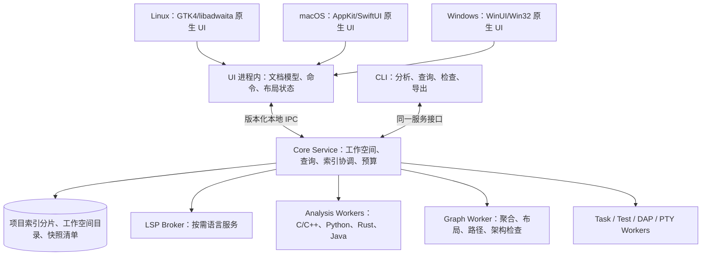

# Symweft：跨项目代码阅读、分析与 IDE 设计

版本：v0.4 分析引擎与实时关系优先  
日期：2026-10-18  
产品名称：Symweft（织源）  
文档性质：可用于产品评审、技术预研、任务拆分和验收设计；性能数字是待验证的工程目标，不是实测结论。

配套文档：[UI 设计交付要点](02-UI设计交付要点.md)。

**最新工程优先级：分析引擎是核心，以低资源、快速增量分析与 IDE 即时关系查询为第一主线。** 引擎与 UI 解耦，但直接参与活动文档的修订、未保存内容与关系查询。通用 IDE 功能围绕这条链路补齐。当前实现和下一阶段门槛见 [分析引擎与实时关系设计](05-分析引擎与实时关系设计.md)，该文修订早期的实施顺序。

已确认产品约束（最新）：**软件名 Symweft（织源）；三套原生前端，不要求同步。当前开发机为 macOS，因此先搭建 macOS；Linux/GNOME/Ubuntu 仍是后续重点，Windows 更后。主题默认实时跟随系统，现有设计稿近黑配色过深，需要提亮且完整支持浅色。**详见 [开发记录](03-开发记录.md)。

阅读索引：

- 产品范围：第 0–4 节，定位、对标、工作空间、需求与优先级。
- 能力设计：第 5–10 节，IDE、分析语义、语言适配、图谱、跨项目与规则。
- 工程实现：第 11–16 节，架构、编辑器、存储、增量、API 与 GPU。
- 质量约束：第 17–20 节，性能、跨平台、可靠性与验证。
- 落地计划：第 21–27 节，用户流程、配置、代码组织、研发分期与验收。
- 资料来源：第 28 节，官方参考链接及使用边界。

## 0. 核心结论

建议建设一个**以代码理解为中心、本地优先、按需启动语言服务的桌面 IDE**。核心价值不是把编辑器与若干图表拼在一起，而是建立一个统一的、可查询的代码关系模型，使代码、调用图、控制流、架构、变更影响和跨项目依赖能够互相定位，并且每条关系都能解释来源。

五个不可牺牲的重点：

1. **多语言深度分析**：Python、C、C++、Rust、Java 为核心语言。必须区分编辑能力、语法分析、语义分析和深度程序分析，不能把“能高亮”称为完整支持。
2. **跨项目架构与调用分析**：工作空间可以包含多个仓库、多个构建目标、多个语言环境；既支持同语言依赖，也支持有证据的 FFI、RPC、HTTP、消息边界连接。
3. **低资源占用**：阅读模式无需启动全部 LSP、JVM、编译器和调试器；索引、查询、缓存、图布局均有预算、取消和降级机制。
4. **GPU 加速的专业桌面 UI**：代码与图谱流畅联动，静止时停止无意义重绘；集成显卡与软件渲染都有可用路径。
5. **可信、可解释的结果**：准确展示分析范围、构建配置、快照、未解析关系、动态候选和过期状态；用户能从图上的边回到具体代码与分析依据。

主推荐技术路线：**共享 Rust 核心 + Linux GTK4/libadwaita 原生前端 + macOS Swift/AppKit/SwiftUI 原生前端 + 后续 Windows WinUI/Win32 原生前端**。分语言分析进程、SQLite 持久化、图算法与查询协议共用，窗口控件、输入、文本布局、无障碍与 GPU 呈现分别适配平台。当前开发顺序为 **macOS → Linux/GNOME → Windows**，各平台独立验收，不要求同步。

“原生”验收以操作行为、系统集成、输入与可访问性、性能和视觉习惯衡量，不以某种编程语言或每个像素必须由系统控件绘制来判定。代码与图谱允许专业自绘，但必须融入平台。Linux 首先针对 GNOME/Ubuntu 打磨；能在 KDE 上运行与达到 KDE 原生体验属于不同支持等级。

## 1. 产品定位与设计原则

### 1.1 产品定位

面向大型、陌生、长期演进或多仓库系统，帮助开发者回答：

- 一个入口最后会经过哪些模块、服务与本地库？
- 某个函数或接口由谁调用、调用谁，哪些关系尚不能确定？
- 修改一个公共类型、RPC 契约或底层库，会影响哪些项目与测试？
- 代码的实际依赖是否符合团队规定的架构？
- 如何在理解过程中直接修改、构建、测试和调试，而不切换工具？

产品形态是桌面应用与共用分析核心的 CLI。离线使用是默认能力；团队索引服务、远程开发和 AI 是可选扩展，不构成核心阅读功能的前置条件。

### 1.2 目标用户

| 用户 | 主要任务 | 最重要的体验 |
|---|---|---|
| 新加入项目的开发者 | 阅读陌生系统、追踪业务路径 | 跳转快、上下文不断、图谱能解释 |
| C/C++ 与系统工程师 | 理解宏、模板、头文件与多构建目标 | 构建配置准确、调用关系可追溯 |
| Python/Java 后端工程师 | 追踪框架入口、服务和数据调用 | 框架规则、接口映射、跨仓库路径 |
| Rust 工程师 | 阅读 crate、trait、宏与异步代码 | 区分静态分派与动态候选 |
| 架构师与技术负责人 | 检查边界、耦合、循环和变更影响 | 层级视图、规则检查、快照对比 |
| 维护与质量工程师 | 复杂度、热点、风险和审计 | 指标口径透明、报告可复现 |

### 1.3 基本原则

- **阅读优先**：打开工程即能搜索、导航、看结构，深度分析逐步补齐。
- **渐进精度**：从语法事实到编译环境语义，再到可选深度分析，不以一次全量索引阻塞全部体验。
- **同一事实，多种视图**：图、树、表格和源码使用相同实体与查询快照。
- **用户控制成本**：可暂停、限额、只分析活动项目、选择变体、清理缓存。
- **不制造确定性**：未知、候选和人工声明都以独立状态存在。
- **核心语义一致，前端符合平台**：实体、关系、命令和分析结果共用，窗口组织、控件、快捷键、菜单与系统集成分别遵循 GNOME、macOS、Windows 的习惯，不要求逐像素相同。

### 1.4 首版边界

首个正式版应具备四类核心语言的常用编辑、导航与基本语义关系，完整打通跨项目证据链；不以一次性达到所有语言全部高级静态分析能力为前提。

当前从 macOS 可运行版本开始，不再要求 Linux 先于 macOS 完成。macOS 和 Windows 各自拥有正式发布门槛与能力清单，平台未完成期间不影响已达标平台发布。核心引擎与协议从首期保持可移植，原生 UI 分期建设。

初期不承诺：任意动态程序完整调用图、跨服务精确执行路径、全语言通用安全证明、全量二进制反编译、完整替代大型商业 IDE 的所有专项工具。逐语言、逐构造公开支持清单。

## 2. 对标基线与差异化

### 2.1 官方能力基线

Understand 官方资料包含实体、引用、架构、指标、图及自动化接口；Source Insight 强调符号导航、上下文预览及关系窗口。这些是本产品应覆盖的能力类别，而不是对任一竞品的穷尽评价。[S1][S2][S3]

| 能力领域 | 本产品基线 | 重点增强方向 |
|---|---|---|
| 源码阅读 | 定义、引用、层次、上下文、搜索 | 代码与图谱双向定位、阅读路径保存 |
| 调用关系 | 调用方、被调用方、递归、候选目标 | 多仓库路径、边界解释、证据过滤 |
| 控制流 | 函数内分支、循环、异常与返回 | 源码同步、条件聚焦、语言专属语义 |
| 架构 | 目录、包、模块、组件依赖 | 跨项目契约、期望架构、实际偏离 |
| 度量 | 规模、复杂度、耦合、继承等 | 变更热点、基线变化、缺失率说明 |
| IDE | 编辑、构建、测试、调试、Git | 按需启动，保留轻量阅读路径 |
| 资源体验 | 增量处理、后台任务 | 总进程预算、冻结非活动工程、能耗可见 |

“比 Understand 更丰富”是本产品的设计目标。跨项目、跨语言、运行时融合等能力应以可重复任务与实测比较验证，不预先宣称竞品没有这些能力或本产品已经全面胜出。

### 2.2 可形成辨识度的功能

1. **跨项目系统地图**：项目、包、服务、契约、符号共享分层模型。
2. **关系证据面板**：展示调用点、绑定依据、构建变体、生成来源、未解析原因。
3. **变更影响解释**：结果给出传播路径、假设、受影响契约与建议测试。
4. **阅读旅程**：保存入口、展开路径、注释、书签、过滤与快照，形成可复查的技术说明。
5. **架构演进对比**：比较两个快照的边界、新依赖、循环和规则违反。
6. **资源预算模式**：用户能看到当前运行的语言服务与成本，并在阅读/开发/深度分析间切换。

## 3. 工作空间与核心概念

### 3.1 概念模型

```text
Workspace 工作空间
 ├─ Project 项目 / 仓库
 │   ├─ Worktree 工作副本与代码修订
 │   ├─ Build Target 构建目标
 │   │   └─ Variant 配置、平台、特性、工具链
 │   └─ Package / Module / File / Symbol
 ├─ System / Component / Service 架构组织
 ├─ Contract 接口、ABI、RPC、HTTP、Topic
 ├─ SnapshotSet 跨项目快照集合
 ├─ Architecture Rules 架构规则
 └─ Saved Views / Reading Trails 阅读资产
```

- Project 可以是 Git 仓库、普通目录或只读索引包，不等同于一个进程或服务。
- 一个仓库可以生成多个服务；一个组件也可以跨多个仓库。组织关系单独建模，不用目录强行代替架构。
- Variant 包含 C++ 宏与编译选项、Rust features/target、Java classpath/modulepath、Python 环境与平台等。
- 工作空间可以同时打开多个语言项目，但深度服务按活动范围和预算启动。
- 外部依赖缺少源码时显示外部占位实体，保留包坐标、版本和契约，不伪造实现。

### 3.2 快照集合

跨仓库查询必须绑定显式的 `SnapshotSet`，记录每个项目的 revision、dirty 文件摘要、配置与索引 generation。可由用户手动选定，也可从产品发布清单导入。

跨仓库不存在天然“同一时刻”的提交。UI 应显示“工作空间当前组合”或“发布清单组合”，并检查契约版本是否匹配。索引生成时间不等同于源码版本；混合新旧索引必须有标识。

### 3.3 三种工作模式

| 模式 | 默认运行 | 默认不运行 | 适用情境 |
|---|---|---|---|
| 阅读 | UI、查询、活动文件语法、已有索引 | 全语言 LSP、调试器、构建和全库重分析 | 浏览、评审、架构理解 |
| 开发 | 阅读能力 + 活动项目语言服务 | 非活动项目重服务 | 编辑、构建、测试、调试 |
| 深度分析 | 用户选定的完整语义任务、契约与规则分析 | 无关项目任务 | 建立基线、发布检查 |

模式决定服务与预算，不决定文件是否可编辑。用户在阅读模式修改文件时可使用基础编辑；需要补全、重命名等能力时按需启用服务。

## 4. 功能需求与优先级

优先级定义：P0 是首个正式版核心；P1 是后续重点增强；P2 是可选扩展。研发 MVP 的范围另见第 24 节。

| 编号 | 需求 | 优先级 | 核心验收 |
|---|---|---|---|
| R01 | 多根、多项目、多仓库工作空间 | P0 | 五个示例仓库可联合查询，仓库身份不混淆 |
| R02 | 四类核心语言的编辑与导航 | P0 | 按语言能力清单通过用例，不用统一勾选掩盖差异 |
| R03 | 定义、引用、实现、符号与全文搜索 | P0 | 有版本与范围信息，缺失环境可降级 |
| R04 | 调用图、调用树、继承与依赖图 | P0 | 每条边能定位证据，递归与截断可见 |
| R05 | 四类语言源码级控制流 | P0 | 常用构造通过测试；异常与异步限制可见 |
| R06 | 分层架构图与依赖矩阵 | P0 | 仓库到符号逐层钻取，可按关系种类过滤 |
| R07 | 跨项目同语言符号关联 | P0 | 依赖版本、构建配置、外部占位正确 |
| R08 | 显式 FFI / RPC 契约桥接 | P0 | 至少完成固定支持范围的 gRPC 与 C ABI/PyO3 示例 |
| R09 | 构建、测试、终端、基础调试与 Git | P0 | 开发闭环可完成，语言与平台覆盖明确 |
| R10 | 增量索引、取消、恢复与资源预算 | P0 | UI 不等待全量索引；故障不破坏已发布快照 |
| R11 | 基础指标、架构循环与导出 | P0 | 口径可查、导出带快照与分析条件 |
| R12 | 架构规则与 CI 退出码 | P0 | 同一快照 GUI/CLI 结果一致 |
| R13 | 更丰富框架与动态边界规则 | P1 | 规则版本化，候选与确定分开 |
| R14 | 跨仓库变更影响与快照差异 | P1 | 结果附传播路径及未解析边界 |
| R15 | 运行时覆盖与调用链叠加 | P1 | 标明采样、环境、时间；不能当作完整静态调用图 |
| R16 | 高级数据流、切片与专项规则 | P1/P2 | 逐语言定义，不宣称全语言等价 |
| R17 | 团队共享只读索引与远程分析 | P1 | 本地仍可独立使用，权限边界清楚 |
| R18 | 可选 AI 问答与解释 | P2 | 所有代码结论能追溯，默认不上传源码 |

## 5. IDE 通用功能

### 5.1 编辑器与导航

- 多标签、预览标签、分屏、固定标签、最近文件、跳转历史、面包屑。
- 增量语法高亮、语义高亮、代码折叠、括号配对、缩进辅助线、行号、诊断标记。
- 多光标、列选择、块缩进、查找替换、正则、跨文件替换预览、撤销与重做。
- 定义/声明/实现/类型定义跳转；找引用；符号、文件与命令统一入口。
- 悬浮说明、签名帮助、补全、代码动作、格式化、组织 import、能力允许时的语义重命名。
- Git diff、冲突编辑、只读版本、外部修改检测、文件编码、CRLF/LF、恢复日志。
- 中日韩输入法、组合字符、Emoji、双向文本和高 DPI 正确性；不可把 byte offset 当视觉列。
- 大文件模式：超长行关闭高成本布局；二进制文件进入十六进制/元信息预览；不强制加载整文件语法树。

LSP 是语言能力的对接协议，并非所有服务都实现相同方法。服务启动后通过 capability negotiation 决定菜单、快捷键与降级提示。[S6]

### 5.2 构建与运行

支持可配置任务，先覆盖 CMake/Ninja、Cargo、Python 解释器与虚拟环境、Maven/Gradle。任务记录工作目录、参数数组、环境引用、依赖任务与输出解析器；默认使用参数数组启动进程，明确选择 shell 才按 shell 解释。

首次导入先扫描工程描述和现有构建元数据；生成代码、运行 build.rs、proc-macro、Gradle/Maven 插件和任意脚本都属于可能执行项目代码的操作，由工程信任策略控制。

构建输出中的错误可导航；支持停止任务树、重跑失败任务、运行配置、环境切换、源路径映射。CLI 与 GUI 使用同一任务描述，避免两套配置漂移。

### 5.3 测试

测试树按项目、框架、文件与用例组织；支持单测、目录测试、失败重跑、输出定位和覆盖率导入。优先适配 pytest/unittest、cargo test、CTest、JUnit。参数化测试、动态发现和测试构建所需的代码执行遵循信任策略。

测试结果与覆盖率需记录代码修订和环境；历史覆盖不能无标识地涂到已经变动的文件上。影响分析给出的“建议测试”不是完整测试集证明。

### 5.4 调试

以 DAP 对接断点、条件断点、调用栈、线程、变量、监视、异常、步进和源码定位。[S7]

| 语言 | 初始适配方向 | 限制与发布要求 |
|---|---|---|
| Python | debugpy | 分清 IDE 所用环境与被调试环境 |
| C/C++ | lldb-dap；后续 GDB 对接 | Windows MSVC/PDB 等组合必须单独验证 |
| Rust | lldb-dap + Rust pretty printers | 编译器、平台和变量展示单独测试 |
| Java | Java Debug Server 对接 | 管理启动 JVM 与项目目标 JDK 的差异 |

上述是适配候选，不代表安装某个适配器即可跨平台等价可用。原生 Windows 工具链调试是独立里程碑；不得以“支持 DAP”直接宣称全面兼容。[S15][S16][S17]

### 5.5 Git 与扩展

Git 首版提供工作区变化、暂存/取消暂存、提交、分支切换、blame、日志和 diff。多仓库提交显式展示每个仓库的变化，避免让用户误以为跨仓库提交原子完成。

扩展按主题/快捷键、语言服务、分析规则、导入导出分层。首版采用声明式扩展与进程外工具，后续再开放受限 WASM 规则；不能因插件运行在进程外就把它视为安全沙箱。

## 6. 分析层次与结果语义

### 6.1 四级分析

| 层级 | 输入 | 输出 | 成本与边界 |
|---|---|---|---|
| A0 文本 | 文件内容 | 全文搜索、文件结构 | 成本低，不宣称符号解析 |
| A1 语法 | 增量语法树 | 声明、词法作用域、语法调用点、源码流程 | 可处理不完整代码；不能仅凭语法确认调用目标 |
| A2 语义 | 构建环境、类型、包依赖、语言前端 | 绑定、类型、真实引用、直接调用及分派候选 | 精度依赖配置完整性 |
| A3 深度 | A2 + 选定闭世界假设/算法 | 指针分析、数据流、切片、更精细候选 | 时间与内存高；按语言、范围显式启用 |

Tree-sitter 用于快速、可容错的增量语法基础，但不承担编译器语义解析的全部责任。[S8]

### 6.2 关系分类

每条关系至少包含以下互相独立的维度：

| 维度 | 取值示例 | 含义 |
|---|---|---|
| relation_kind | calls / imports / inherits / implements / reads / writes / rpc / ffi | 关系类型 |
| resolution | resolved / candidate / unresolved | 当前是否解析到目标 |
| dispatch | direct / virtual / indirect / dynamic | 分派方式 |
| provenance | semantic / syntax / framework-rule / user-map / runtime | 证据来源 |
| freshness | current / stale / overlay | 对应代码与索引状态 |
| scope | language、variant、snapshot、assumptions | 结论成立范围 |

“语义解析”“运行时观测”“人工映射”不是由低到高的单一可信度刻度。运行时可以证明某次观测发生过，不能证明其他路径不存在；人工映射可以表达部署事实，但不能自动当作编译器证明。

UI 默认不显示未经校准的“95% 可信”。候选排序可以有内部启发式分数，但面向用户应展示确定依据、候选数量与限制。

### 6.3 覆盖与完整性

至少公开：扫描文件数、语法成功数、语义已分析数、缺失环境数、跳过数、失败数、未解析调用点数、候选调用点数与未知文件数。

调用点解析率的分母是**已识别的调用点**，不能称为全程序真实调用覆盖率。深度分析可能增加或减少候选，不把“边更多”当作质量提升。

### 6.4 调用图并不等于执行顺序

调用图表达可能调用关系，控制流图表达函数内控制转移。跨多个进程的路径表达边界可达关系；只有绑定到具体 trace 时才展示该次观测的时序。异步回调、消息消费和并发不能强行画成单一确定执行链。

## 7. 分语言分析方案

### 7.1 共用分析器接口

每个适配器实现：`discover`、`capabilities`、`index`、`update`、`resolve`、`control_flow`、`metrics`、`cancel`、`health`。输出统一事实协议，而非直接修改 UI 或数据库。

能力需精确到构造与配置，例如 `rust.callgraph.trait_object=candidate`、`cpp.cfg.exceptions=optional`，并随分析器版本进入结果元数据。

### 7.2 C/C++

**编辑路径**：clangd。**批量事实路径**：基于 Clang LibTooling/AST 与 CFG 的受控分析 worker。使用 `compile_commands.json`、响应文件、include 路径、sysroot、宏、语言标准和工具链信息；无构建配置时回到语法模式。[S9][S10]

重点处理：

- C/C++ 声明与定义、重载、命名空间、模板、继承、虚调用与成员引用。
- 对每个 TU/构建目标保留上下文；同一头文件在不同宏条件下可能产生不同事实。
- 模板源模式与实例分开：默认按源模式聚合，必要时展开具体实例；不无界物化所有实例。
- 宏展开位置与拼写位置双重锚点；生成文件与原始定义可往返定位。
- C 函数指针和 C++ 虚调用默认输出候选与假设。CHA 等保守策略要注明闭世界范围；精准 points-to 属于 A3。
- 非活动预处理分支只做语法层信息，并显示“未在当前变体编译”。
- 头文件依赖失效以 include 与宏相关性为依据；不能只重分析被编辑的头文件。
- PCH/模块缓存记录编译器版本和选项；禁用不兼容复用。

clangd 交互索引与本产品持久索引目标不同。首版不读取其私有内存结构，不假设可以无成本共享完整 AST；统一调度避免同一目标同时进行两次后台全量扫描。后续通过受控导入或自维护适配层减少重复。

### 7.3 Python

**编辑路径**：Pyright 或经验证的兼容语言服务，配合独立格式化与 lint 工具。**事实路径**：语法/AST 提取器 + 模块、作用域、import 解析 + 有限类型与绑定分析；从可用的标准接口或版本固定的适配层补充语义。[S11]

不得假设 Pyright 提供稳定、公开的完整程序分析导出 API，也不能把批量遍历 LSP 引用请求当作低成本全库索引方案。若采用其内部接口，必须隔离版本、维护适配测试与回退机制。

重点处理：

- venv/conda/解释器、`pyproject.toml`、可编辑安装、namespace package、`src` 布局与 stub。
- 模块级函数、类、方法、属性、装饰器、闭包、comprehension、async/await、generator。
- 反射、`getattr`、`eval`、monkey patch、动态 import 等进入 unresolved/candidate；运行时补充另存。
- 函数对象传播使用有界数据流；无类型信息时不能仅按函数名连边。
- 装饰器保留“源码声明”“包装后入口”和映射关系，避免悄悄改变调用语义。
- FastAPI、Django、Flask、pytest 等以版本化规则逐步支持。路由声明是契约事实，部署目标关联仍需要配置。
- 静态分析不 import 用户模块，以免分析过程中执行代码。

### 7.4 Rust

**编辑路径**：rust-analyzer。**事实路径**：优先导入经验证版本的 rust-analyzer SCIP 索引；调用语义与 CFG 由专门适配补充。SCIP 有符号与出现位置等信息，但并不直接等价于完整调用图或控制流图。[S12][S14]

重点处理：

- `cargo metadata`、workspace、crate graph、features、target、edition 与工具链版本。
- 宏源位置与展开位置、trait/impl、泛型、associated items、闭包、async/await。
- 静态 trait 分派与 `dyn Trait` 动态分派分别建模；泛型源码聚合与单态化实例分开。
- build.rs 与 proc-macro 涉及代码执行，受工程信任策略控制；禁用时清楚列出语义缺口。
- 源码 CFG 首先覆盖普通 Rust 控制结构、`?`、match、循环、return、await 挂起点。借用检查器事实、MIR、drop/unwind 和 async 状态机级语义不冒充首版源码 CFG。
- rustc 内部 API 与 MIR 集成属于版本耦合强的可选适配，不能作为稳定工具链下基础阅读的唯一依赖。
- rust-analyzer SCIP 输出本身也需要去重、冲突检测与能力回归，不能把存在导出命令等同于所有语义问题已解决。

### 7.5 Java

**编辑路径**：Eclipse JDT LS。**事实路径**：基于 JDT 绑定模型的受控导出适配或独立 headless JDT worker，统一调度，避免两个 JVM 长期重复持有同一工程模型。[S13]

重点处理：

- Maven、Gradle、classpath、modulepath、多模块、目标 JDK 与语言服务启动 JDK。
- 类、接口、泛型、lambda、方法引用、继承、重载与 override。
- 接口/虚方法以 CHA 起步、可选 RTA 细化，并公开闭世界与可达对象假设。
- Spring 注解、DI 与路由作为可选框架规则；反射、动态代理、ServiceLoader 不假定静态唯一目标。
- Lombok、注解处理器、生成源码需明确来源；处理器执行受信任策略控制。
- JVM 进程按需启动，非活动工程可卸载/休眠。Java 语言包的内存预算必须单独测量。

### 7.6 首个正式版能力合同

| 能力 | C/C++ | Python | Rust | Java |
|---|---|---|---|---|
| 语法、搜索、outline | 完整基础 | 完整基础 | 完整基础 | 完整基础 |
| 定义、引用、类型导航 | 构建环境完整时语义级 | 环境与类型信息相关 | crate 配置完整时语义级 | classpath 完整时语义级 |
| 直接调用 | 语义级 | 解析范围内语义级 | 解析范围内语义级 | 语义级 |
| 动态分派 | 候选，指针深度另选 | 候选/未知较多 | dyn 候选 | 接口/虚调用候选 |
| 函数内源码 CFG | 常规构造与可选异常边 | 常规、异常、async 标记 | 源码级，不等同 MIR | 常规与异常边 |
| 跨项目关系 | 目标、ABI 与源码包 | 包环境、显式桥接 | crate、ABI 与桥接 | 包、模块、契约与桥接 |
| 重构 | LSP 支持范围 | 服务支持范围 | 服务支持范围 | 服务支持范围 |
| 深度数据流/切片 | 分阶段 | 有界静态子集 | 后续专项 | 分阶段 |

版本支持采用“已验证工具链组合”列表。初始验证候选为 Python 3.10–3.14、C11/C17/C23、C++17/20/23、Rust stable 的 2021/2024 edition、Java 17/21/25；这些是目标测试范围，不代表全部语法、库和预览特性已经支持。具体发布版本在预研后冻结，不以泛称“最新版本”代替兼容承诺。

## 8. 图谱与代码分析能力

### 8.1 调用图与调用树

支持调用方/被调用方、双向展开、深度限制、聚合、函数/类/文件/模块/项目切换；过滤测试、依赖、生成代码、关系类别、证据来源与构建变体。

默认围绕选中符号展开 1–2 层；每节点扇出上限 50、初始节点上限 300。超过后显示“另有 N 个”，可分页或按模块聚合。默认值可调整，但不能一次把百万节点塞进画布。

递归显示自环；互递归用强连通分量折叠。路径查询返回一组受限可能路径，标明算法、深度、过滤和未完成搜索；“没有找到”只对本次分析范围成立。

### 8.2 控制流图与阅读流程图

提供两个视图：

- **基础块 CFG**：面向技术分析，显示入口、出口、分支、循环、异常和不可达候选。
- **结构化阅读流程**：对 CFG/语法结构进行可逆聚合，显示业务可读语句和源码范围。

阅读流程节点不允许擅自省略语义重要的异常、early return 或 finally；简化部分可展开，并标明当前是否包含异常边。

选中节点高亮源码；选中源码定位包含的基本块。支持条件分支聚焦、循环折叠、正常/异常出口过滤。路径高亮表达控制流可达关系，未经约束求解不能声称每条组合路径都实际可执行。

### 8.3 架构图

至少提供：工作空间系统地图、项目依赖图、包/模块图、组件图、类图、继承图、依赖矩阵 DSM、循环视图。

自动视图按目录、包、crate、build target 生成；用户架构通过规则把实体映射到业务组件。布局坐标、分组和注释与代码事实分开存储，重新索引不覆盖用户布局。

边的聚合维度可选：调用点数量、不同符号对数量、类型引用、包依赖、RPC 操作数量。不能把所有关系简单相加后称为“调用次数”；运行时频次另有单位和采样条件。

### 8.4 指标与质量

首版指标：代码/注释/空行、函数长度、参数数量、嵌套深度、圈复杂度、fan-in/fan-out、包/组件依赖、循环分量、部分 OO 指标。后续加入重复代码、认知复杂度、变更频率、共同变更、覆盖率与热点。

每项指标记录定义版本、适用语言、计数单位与缺失原因。圈复杂度以选定 CFG 的约定计算，例如连通图的 `E − N + 2P`，短路条件与异常边的处理必须固定并公开。语言之间的相似指标不可无说明地直接横比。

“风险热点”展示原始组成项与权重，默认作为排序辅助；Git 活跃度高不自动意味着设计差。

### 8.5 数据流与切片

P1 起提供函数内 def-use、变量读写与局部前后向切片；跨函数通过摘要扩展。别名、闭包、heap、反射、并发、异常均有范围限制。跨语言数据流必须有参数/返回值/契约字段映射；缺少映射时在边界停止，不能把调用可达当作值传播证明。

## 9. 跨项目与跨语言分析

### 9.1 三层关系

| 层次 | 连接对象 | 可得结论 |
|---|---|---|
| 包与构建依赖 | target、artifact、package | 某项目依赖另一构件，不等于具体函数被调用 |
| 符号与 ABI | 声明、定义、导出、绑定 | 支持范围内的跨项目调用候选或确定绑定 |
| 分布式契约 | RPC、HTTP、消息、部署配置 | 接口消费/实现与可能路由，不等于同进程函数调用 |

所有图均保留这三层类型。用户可以在一个系统图中查看，但查看边时必须看得出是链接依赖、函数调用还是服务通信。

### 9.2 项目身份与符号身份

项目身份使用工作空间登记 UUID 与可选远端规范身份；不能单凭目录名或仓库 basename。包身份包含 ecosystem、package coordinate、version、artifact/configuration。

符号逻辑身份建议由 `project/package identity + language + qualified name + signature + relevant variant` 构成；具体实例由 snapshot、文件内容与声明锚点定位。局部变量和匿名闭包可以使用语法路径与邻接 token 指纹，但跨版本映射只能作为候选，不能承诺永久稳定。

C++ USR、SCIP symbol、JDT binding 等作为 provider key 保存，经冲突校验后映射为内部 ID。泛型、条件编译、重载、相同包多版本均要分离。

### 9.3 桥接器

| 桥接 | 证据 | 可自动化部分 | 必须保留的限制 |
|---|---|---|---|
| C ABI / Rust extern | 导出名、头文件、extern 声明、链接配置 | 支持 ABI 的符号对齐 | ABI、target、库版本不同不能合并 |
| Python ↔ Rust/C++ | PyO3、pybind11、CPython 注册与 stub | 已支持规则的导出入口与包装映射 | 动态注册、平台 wheel 可能缺失 |
| Java ↔ native | JNI 名称与注册表、头文件 | 显式注册/导出映射 | 动态 RegisterNatives 可能只能候选 |
| gRPC | proto descriptor、包/服务/方法、生成器与部署清单 | client stub、contract、server handler | 同一契约可能有多个部署实现 |
| HTTP | OpenAPI、路由、客户端与 base URL 配置 | 常量路径与支持的框架 | 网关改写、动态 host、版本路由 |
| 消息 | schema、topic、producer/consumer 配置 | 显式配置关系 | fan-out、运行时分区与订阅条件 |

首版优先完成 C ABI、一个 Python/native 桥和 gRPC；HTTP 框架与消息在 P1 扩展。没有识别规则的代码仍可阅读，并清楚标出断开的边界。

### 9.4 统一示例：Orion Commerce

```text
api-gateway (Java)
  -- gRPC: commerce.order.v1.OrderService/CreateOrder -->
order-service (Java)
  -- gRPC: commerce.risk.v1.RiskService/Assess -->
risk-service (Python)
  -- Python call --> risk_bridge.calculate(...)
  -- PyO3 export mapping --> risk-core::evaluate(...) (Rust)
  -- C ABI --> pricing_core_quote(...) (C++)
```

图上 gRPC 先连接到契约节点，再连接兼容实现；只有部署配置明确时才把默认路径收敛到某个服务。PyO3 和 C ABI 分别展示注册/导出证据。该示例可用作产品演示、集成测试和 UI 共用样例。

### 9.5 联邦查询流程

1. 解析查询范围与 SnapshotSet，校验各索引的配置、版本和权限。
2. 在项目分片内查找符号/关系，依赖缺失时生成外部占位。
3. 通过包坐标、ABI 或契约匹配候选，检查版本、平台、签名和配置。
4. 生成跨边界桥接事实，保留原始证据和规则版本。
5. 按用户选择的关系、证据、深度和预算执行有界遍历。
6. 返回图结果与未解析清单、截断原因、快照、假设。

不执行“函数名相同即自动连边”，也不因两个 HTTP 路径相同就认定它们在生产环境互相调用。

### 9.6 变更影响

区分直接引用影响、潜在传递影响、ABI/契约兼容风险和架构规则变化。结果包括起点、受影响实体、最短解释路径、关系种类与支持该结论的分析范围。

实现修改优先分析直接依赖与相关测试；签名/公共类型/契约变更扩展到消费者。动态绑定与未解析边界给出“影响范围可能不完整”，不可用结果证明无需测试。

## 10. 架构规则与持续检查

支持分层依赖、禁止循环、允许依赖清单、公共 API 边界、组件归属、跨项目契约版本等规则。示例为产品拟定配置格式，不是现成工具语法：

```yaml
schema_version: 1
components:
  domain:
    include: ["order-service:src/**/domain/**"]
  adapters:
    include: ["order-service:src/**/adapters/**"]
rules:
  - id: domain-must-not-depend-on-adapters
    from: domain
    forbid_to: adapters
    relations: [calls, type_ref, imports]
    severity: error
  - id: no-project-cycles
    type: acyclic
    scope: project
    relations: [package_dependency]
```

规则检查必须绑定快照与证据策略；候选关系可配置为 warning，而非默认为确定违规。每条违规展示规则、代码位置、关系依据与修复方向。

基线豁免记录规则 ID、关系身份、理由、负责人和到期时间；代码关系消失时不自动把豁免套到同名新关系。CI 输出 JSON/SARIF/HTML，规范退出码：0 通过、1 规则失败、2 配置/分析错误、3 超时或不完整且策略禁止放行。

## 11. 总体技术架构

### 11.1 分层与进程



首版不把每个子模块都拆成常驻进程。最小运行是 UI + Core；图布局 worker、语言服务、分析 worker、调试和终端按需创建。语法解析可在 core 的受控线程池完成；容易崩溃或需要执行外部工具的任务进程隔离。

图中三个前端是分别构建、分别运行的应用，不在用户机器上同时启动三套 UI。每个前端拥有自己的文档适配、命令路由与布局状态，并对接同一核心协议。

### 11.2 模块职责

| 模块 | 职责 | 不承担的职责 |
|---|---|---|
| Desktop Shell | 窗口、停靠、输入、无障碍、命令 | 不直接遍历全量语义数据 |
| Document Engine | 文本、编辑事务、撤销、位置映射 | 不持久化全工程语义图 |
| Workspace Manager | 工程发现、环境、信任、变体、快照 | 不猜测缺失部署关系 |
| Index Coordinator | 任务依赖、失效、增量、发布、重试 | 不在 UI 线程执行前端分析 |
| Fact Normalizer | provider key 归一化、冲突、证据、导入 | 不静默丢弃冲突事实 |
| Query Engine | 符号、关系、有界路径、联邦查询 | 不无界展开全图 |
| Graph Engine | 聚合、布局、LOD 数据、规则分析 | 不决定源码编辑事务 |
| Language Broker | LSP 生命周期、能力、取消、诊断 | 不把 LSP 当完整静态分析库 |
| Developer Tools | 构建、测试、DAP、Git、PTY | 不绕过工程信任策略 |
| Extension Host | 扩展生命周期与能力授权 | 不默认授予任意文件/网络权限 |

### 11.3 各平台技术选型

| 平台/层 | 推荐路线 | 冻结前验证 | 决策理由 |
|---|---|---|---|
| 共享核心 | Rust、SQLite、分语言 worker | 协议、快照、预算、ABI 生命周期 | 分析结果与核心性能共用 |
| Linux / GNOME | Rust + GTK4 + libadwaita；优先验证 GtkSourceView 5、libpanel | GNOME/Ubuntu、Wayland、IBus/Fcitx、AT-SPI、停靠与大文件 | 匹配用户最迫切桌面，复用成熟输入和文本组件 |
| macOS | Swift + AppKit 主工作台 + 按需 SwiftUI；Metal 图谱 | TextKit/编辑器候选、VoiceOver、IME、窗口与触控板 | 原生桌面行为优先，重型区域可精细控制 |
| Windows | C++/WinRT + WinUI 3/Win32；DirectX 图谱 | 编辑器、TSF/UIA、停靠、DPI、PDB 与安装 | 使用 Windows 原生 UI 与系统接口，后期建设 |
| KDE Plasma 后续适配 | 先验证 GNOME 前端互操作；如需原生同等级，另评估 Qt Widgets/KDE Frameworks | KDE 输入、门户、主题与快捷键 | Linux 不存在能代表所有桌面的单一原生控件体系 |

libadwaita 面向 GNOME，GtkSourceView 提供基于 GtkTextView 的编辑组件，libpanel 提供 GTK4 的面板/停靠基础；它们是候选构件，不保证组合后自动达到本产品全部编辑与性能要求。[S20][S21][S22]

AppKit 与 SwiftUI 可混用；Windows App SDK/WinUI 提供 Windows 桌面能力。具体分工由平台原型验证，不以使用官方框架代替体验验收。[S24][S25]

Qt 从全平台主路线改为 KDE 路线候选或原型对照。它的场景图、桌面控件和许可约束仍可参考，但不再要求 Linux/GNOME、macOS、Windows 共用 Qt UI。[S4][S5][S18]

### 11.4 共享边界与平台适配

| 共用内容 | 各平台独立内容 |
|---|---|
| 实体、关系、证据、快照、分析规则与索引 | 窗口、菜单、工具栏、设置与面板行为 |
| 搜索、调用/路径/影响查询、图聚合与布局 | 文本 shaping、字体 fallback、IME、可访问对象 |
| 文档版本、编辑事务协议、诊断和位置映射 | 文本控件、平台撤销桥、输入与选区呈现 |
| 图节点/边 ID、几何、选择语义和 LOD 策略 | GPU 资源、绘制提交、文字呈现和设备恢复 |
| LSP/DAP/任务模型与工作空间配置 | 文件选择、门户/权限、通知、钥匙串、安装更新 |

- Linux 优先使用 gtk-rs 及经验证的库绑定；缺少可靠绑定时使用小型 C 适配，不把业务塞进 FFI 胶水。
- macOS 前端通过稳定 C ABI 访问少量进程内能力，通过 IPC 访问 core；Swift 不直接依赖 Rust 内部布局。
- Windows 使用相同 C ABI/IPC；C++/WinRT 处理系统 UI 与输入，不复制分析业务。
- FFI 只传 ID、带长度切片、不可变批次与有生命周期的句柄；不跨边界传播 panic/异常。
- 各平台 UI 与渲染回调按平台线程约束工作；worker 不直接操作窗口对象。
- 统一命令 ID 和能力状态，平台可采用不同控件与菜单位置；不下发 GTK/SwiftUI/XAML 控件树作为共享 UI 协议。
- 核心协议至少兼容当前与前一个已发布前端版本，使用 feature negotiation；Linux 引擎更新不能无提示破坏仍在支持的 macOS 前端。
- 复用比例以代码与维护成本测量，不预先承诺“90% 共用”。新增成本集中于原生交互、渲染、编辑器和平台测试，并非分析核心重写三遍。

### 11.5 IPC 与协议

本地控制使用版本化、长度分帧的 Protobuf 或同等类型化协议；开发调试可提供 JSON 输出。macOS/Linux 使用私有 Unix domain socket，Windows 使用具访问控制的 named pipe；只绑定当前用户会话，不默认开放 TCP 端口。

协议含 request ID、取消 token、workspace ID、snapshot ID、document revision、deadline、budget、capability、sequence。大结果流式分页，背压防止 worker 挤爆 UI 队列。外部 LSP/DAP 继续使用各自标准协议，不为统一而重新封装成不兼容变种。

## 12. 编辑器工程设计

### 12.1 文本与位置

使用统一的文档/编辑事务协议，支持局部编辑、行索引和快照。采用成熟原生文本控件时，其 buffer 是活动文档唯一编辑权威；Rust 维护用于分析的版本化镜像，可使用 rope/piece table。不得让 Rust rope 与控件 buffer 同时独立裁决文本、撤销与选区。

原生控件完成输入事务后，适配器发送 `base_revision + edits + origin + resulting_hash`；core 更新镜像并回传版本确认。LSP 编辑/重构先在前端检查 revision，再作为一个原生撤销事务应用，使用 origin 防止回传形成循环。未打开文件由受控文件事务处理，打开文件必须经过其文档适配器。

同时维护 UTF-8 byte、Unicode scalar、UTF-16 code unit 与行列映射，依据 LSP 协商的 position encoding 转换。选区、诊断和源码锚点使用同一版本坐标，不能把旧诊断直接标到新行号。

撤销记录编辑事务而非整文件副本；大批替换作为可预览事务。恢复日志存最小必要增量并有大小与保留期限，恢复前展示可恢复文件。

### 12.2 显示与交互

Linux 首选验证 **GtkSourceView 5**，以插件/适配器对接语义高亮、诊断、引用、导航和代码图谱。[S21] 代码折叠、多光标、大文件、超长行等需求逐项验证；候选组件没有的功能单独实现或更换组件，不能按“代码编辑控件”名称推定全部支持。

macOS 优先验证 AppKit/TextKit 体系下的编辑器组件；复杂编辑交互放 AppKit，SwiftUI 用于合适的设置、检查器与辅助区域。Windows 预研成熟原生编辑组件与自定义可视区域路径，分别验证 TSF、UIA 与大文件。

默认不同时自研三套完整文本布局引擎。共享语义和事务协议；文本呈现、IME、命中与无障碍使用平台成熟能力。若成熟编辑组件无法通过硬指标，才对瓶颈区域开发自绘层。GPU 要求覆盖应用合成与图谱，不强迫将所有文本组件替换为自行管理字形的实现。

GPU 绘制不承担所有成本：shaping、词法分析、换行和 hit-test 仍主要消耗 CPU。三个前端均实现原生可访问语义，Linux 对接 AT-SPI、macOS 对接 NSAccessibility、Windows 对接 UI Automation。屏幕上有字形不等于屏幕阅读器可用。

### 12.3 编辑器技术关卡

预研必须验证：100 万行文件的局部导航、中文 IME、组合字符、混合宽字符、超长行、软换行、多光标、查找、屏幕阅读器、不同 DPI 和三平台输入延迟。

先验证 macOS 编辑协议与输入，Linux 后续接入，Windows 后续沿用相同协议验证。每个平台通过后才能宣布对应能力，成熟编辑组件与 Rust 镜像的内存复制也计入预算。不得为“统一控件”“全 Rust”或“全 GPU”牺牲输入正确性；重要编辑需求不能在验收时被静默删减。

## 13. 统一数据模型与存储

### 13.1 存储原则

当前实现状态与下一步细化见 [分析结果持久化与快速查询](07-分析结果持久化与快速查询.md)。持久化尚未接入；先实现 A1 跨重启复用，再逐步加入完整语义关系。

默认使用嵌入式存储，不要求用户安装数据库服务。SQLite 存实体、关系、证据、状态、指标和架构定义；全文检索优先用 FTS5，路径/符号候选可配紧凑内存索引。原始源码默认从工作副本读取；历史快照源码按需存储或从 VCS 取回。

2026-10-18 实施补充：已用 QEMU 对 SQLite、连续事实包及混合后端做同数据比较，当前采用 SQLite WAL + 版本化紧凑事实块，不将 SQLite 作为不可更改的前提。已落地 A1 文件快照与二级名字候选，尚无本节目标中的 A2 语义边/FTS/跨项目 generation。全量 6,723 文件的生产命令 15.47 秒、核心峰值 RSS 35.94 MiB；完整证据、替代后端的收益与迁移条件见 [QEMU 存储报告](09-QEMU性能与存储选型报告.md)。百万/千万语义事实仍需单独验证。

项目/配置按逻辑分片，首版不必为每个 TU 建一个数据库。工作空间目录保存身份、契约桥、快照清单与视图。热点邻接页按需缓存，避免同时把全量 SQLite、内存图数据库和完整搜索索引常驻。

SQLite WAL 支持读写并发，但单库仍须串行写入，长读事务会影响 checkpoint。使用单写队列、有限读池与短查询；不把 UI 页面停留时间变成数据库事务时间。[S19]

### 13.2 逻辑实体

| 实体 | 关键字段 |
|---|---|
| Project | id、规范身份、root URI、kind |
| BuildVariant | target、toolchain、platform、options_hash、environment_hash |
| Snapshot | revision、dirty_content_manifest、generation、analysis_config_hash |
| SnapshotSet | project → snapshot 映射、environment、contract compatibility |
| FileVersion | project、relative URI、content_hash、encoding、origin |
| Symbol | logical_key、provider_key、language、kind、name、signature |
| SymbolInstance | symbol、snapshot、variant、file_version、source_range |
| CallSite | caller instance、file range、dispatch、resolution、candidate_set |
| Fact | source、target/placeholder、relation_kind、context、resolution |
| Evidence | provider、rule_version、source anchor、assumptions、payload |
| FactEvidence | fact 与 evidence 多对多关系 |
| Contract | ecosystem、namespace、operation、schema_version/hash |
| Bridge | endpoint、contract、binding/deployment mapping、evidence |
| Metric | entity、definition_version、value、unit、status |
| View/Trail | query、snapshot policy、layout、annotation、bookmarks |

Fact 与 Evidence 分离：同一调用事实可同时有语义、契约与运行时证据，不重复计算调用点；一个调用点的多个候选也不能当作多次确定调用。

### 13.3 简化 schema 示例

以下只描述关键索引关系，完整迁移需补充外键、枚举、唯一性与清理策略：

```sql
CREATE TABLE symbol_instance (
    id BLOB PRIMARY KEY,
    logical_symbol_id BLOB NOT NULL,
    snapshot_id BLOB NOT NULL,
    variant_id BLOB NOT NULL,
    file_version_id BLOB NOT NULL,
    start_byte INTEGER NOT NULL,
    end_byte INTEGER NOT NULL,
    kind INTEGER NOT NULL
);
CREATE TABLE fact (
    id BLOB PRIMARY KEY,
    generation_id INTEGER NOT NULL,
    source_id BLOB NOT NULL,
    target_id BLOB,
    callsite_id BLOB,
    relation_kind INTEGER NOT NULL,
    resolution INTEGER NOT NULL,
    context_hash BLOB NOT NULL
);
CREATE INDEX fact_out ON fact(generation_id, source_id, relation_kind);
CREATE INDEX fact_in ON fact(generation_id, target_id, relation_kind);
CREATE TABLE fact_evidence (
    fact_id BLOB NOT NULL,
    evidence_id BLOB NOT NULL,
    PRIMARY KEY (fact_id, evidence_id)
);
```

实体 ID 使用带域区分的强哈希/内部标识策略；内容 hash 不直接代替实体身份。查重时比较规范内容，检测冲突。主键、字符串字典、range、邻接缓存等真实空间开销必须通过数据集测量，不能用“每条边只有两个整数”估算整库。

### 13.4 发布、一致性与回收

worker 写临时批次，core 校验后事务提交为新 generation；构建完成再更新项目可见 generation。跨项目不假设多个 SQLite 文件拥有天然的原子事务，而是：

1. 为每个项目准备可读取 generation。
2. 校验配置、桥接与内容清单。
3. 原子发布引用这些 generation 的工作空间 manifest。
4. 查询固定 manifest，不在一次遍历中偷偷切到更新分片。
5. 旧 generation 保留到所有查询 lease 释放，再按保留策略回收。

查询 lease 只是元数据生命周期管理，不要求一直持有 SQLite 读事务。大查询分块读取固定 generation；同一 generation 的必要数据在 lease 期间不被删除。崩溃后 manifest 指向的集合仍可读取，未发布批次可丢弃或恢复。

### 13.5 索引位置与格式

默认放平台缓存目录，按 workspace/project ID 隔离，不把几 GB 数据写进源码仓库。工程内仅保留可共享配置；本机绝对路径、凭据和用户布局使用本地配置。

索引包包含 schema、analyzer/toolchain、配置、内容 hash、快照和校验清单。导入不信任包内路径，不执行内含脚本，不把索引包当作可执行插件。

迁移采用版本检查、备份/重建策略与可回滚 manifest。缓存可以重建；用户手工架构、注释、规则和阅读资产需独立备份，不能随“清理索引”丢失。

## 14. 增量分析与实时编辑

### 14.1 状态机

```text
discovered → scheduled → parsing → resolving → normalizing
           → validating → publishing → ready
任一步骤可进入 cancelled / failed / blocked-by-environment
源码更新可令 ready 进入 stale，再排入增量队列
```

“blocked-by-environment”表示缺少工具链/依赖/信任条件，不是应用卡住。UI 展示原因、受影响能力与可操作的修复入口。

### 14.2 增量流程

1. 合并文件事件，读取内容并校验 hash，识别移动/删除/外部修改。
2. 活动文档先更新语法与 outline；常规 debounce 150–300 ms，可因输入与设备调整。
3. 记录该文件产生的声明、导入、导出、调用、宏/构建依赖等拥有关系。
4. 由签名/导出/环境变化传播失效；仅函数实现变化通常不必重建全部消费者。
5. 重新分析受影响单元，删除旧批次拥有的事实，提交新批次，避免“只追加不删除”留下幽灵调用。
6. 结果携带输入版本；回包时旧 revision 丢弃或缓存为旧快照，不能覆盖新版本。
7. 对暂未完成的依赖显示 stale/partial，不误报为当前精确结果。

### 14.3 缓存键与失效

缓存键至少含源码内容、依赖摘要、工具链/前端版本、语言标准、目标平台、宏/features、路径解析环境、规则版本和 schema。系统头文件、stub、JAR、生成源码变化也可能触发失效。

热度分为代码结构与真实用户关注两套指标，分别输出文件/符号排名。结构应基于有证据的静态关系，不等于运行频率；用户关注采用有效前台停留、打开次数、最近访问与衰减分数，预读/扫描不贡献用户关注。本轮只有 syntax_proxy 的结构候选，准确入度为 unknown。已实现按字节的事实缓存、动态压力预算、手动/关闭开关、受限本地依赖预读；高级准入策略和预测均以实测等待收益决定。资源口径、局限和 UI 交付见 [缓存评估](08-大规模索引与自适应缓存评估.md) 与 UI 文档补充。

不能只比较文件 mtime；不能把 Python 不同解释器、Rust 不同 features、C++ 不同宏变体混成一个缓存。缓存采用分层配额与 LRU/代价权重回收。

### 14.4 未保存文件 overlay

未保存文档用 `document_id + revision + content_hash` 标识，overlay 覆盖当前文件及其失效关系，不直接修改磁盘基线索引。图查询明确选择“已保存快照”或“包含当前编辑”。

来自失效调用点的旧边被遮蔽，不能简单把新边并入旧图。跨文件语义尚未重算时标注不完整。多文件重构或批量编辑以一个编辑事务组织，重新分析成功后再发布可用语义结果。

### 14.5 调度与取消

优先级顺序：输入/编辑反馈 → 当前符号与图查询 → 当前文件语义 → 活动项目增量 → 跨项目分析 → 指标与报告。高优先级任务可取消尚未运行任务，并在批次边界抢占低优先级工作。

外部服务未必响应取消。先发协议取消/停止请求；超过 deadline 可终止该 worker 进程树，保留最后一次已发布结果。失败任务指数退避，有重试上限与可诊断日志。

## 15. 查询 API 与扩展接口

### 15.1 内部查询示例

以下是拟定产品 API，需在实现中冻结字段语义：

```json
{
  "method": "graph.expand",
  "request_id": "q-1042",
  "workspace_id": "orion",
  "snapshot_set_id": "release-2026-10-18",
  "root": {"symbol_instance_id": "sym-order-create"},
  "direction": "outgoing",
  "relations": ["calls", "rpc", "ffi"],
  "include_resolution": ["resolved", "candidate"],
  "include_provenance": ["semantic", "framework-rule", "user-map"],
  "max_depth": 3,
  "budget": {"nodes": 300, "edges": 1000, "time_ms": 1200},
  "overlay_revision": null
}
```

```json
{
  "request_id": "q-1042",
  "snapshot_set_id": "release-2026-10-18",
  "nodes": [],
  "edges": [],
  "page_cursor": "opaque-cursor",
  "status": "partial",
  "limits_hit": ["node_budget"],
  "coverage": {
    "recognized_callsites": 240,
    "resolved_callsites": 216,
    "candidate_callsites": 18,
    "unresolved_callsites": 6
  },
  "assumptions": ["java-cha: indexed classpath treated as closed world"],
  "warnings": ["deployment mapping missing for risk-service staging"]
}
```

示例空数组是格式展示，不是查询实测。覆盖统计必须声明统计范围是此次查询涉及的已分析区域。分页 cursor 绑定快照、过滤与排序，过期时要求重查，不能继续到另一个快照。

### 15.2 规划中的 CLI

```text
symweft workspace validate orion.symweft.toml
symweft index --workspace orion.symweft.toml --profile balanced
symweft query callers --symbol <id> --snapshot <id> --format json
symweft graph export --view <id> --format svg --output architecture.svg
symweft check --workspace orion.symweft.toml --rules architecture.yml
symweft snapshot compare <old> <new> --format json
```

CLI 支持无图形环境；分析核心不能依赖 GTK/AppKit/XAML 初始化或 GPU 才能运行。机器输出稳定、带 schema，诊断写 stderr，结果写 stdout；避免日志污染自动化结果。

### 15.3 可编程能力

先提供稳定的查询/导出进程协议和 Python SDK 薄封装，后续开放受限规则接口。SDK 返回实体句柄与分页结果，不把整个数据库载入 Python。版本协商、弃用周期、样例与兼容测试属于 API 发布内容。

SCIP 作为输入/输出互通格式之一；本产品的 CFG、契约桥、构建变体与证据模型使用附加 schema，不能声称纯 SCIP 已能保存全部分析语义。[S14]

## 16. 图谱引擎与 GPU 渲染

### 16.1 数据、布局、渲染分离

- 数据图：可达百万级实体，存储与分页查询处理。
- 展示图：经过范围、过滤、聚合与预算后生成。
- 布局图：计算节点位置、分组、端口和边路由，放 worker。
- 渲染场景：只保存当前视口及预取区域的可绘制批次。

GPU 提速的是绘制、合成和部分几何计算，不会自动解决名称解析、数据库查询或复杂布局。

### 16.2 布局算法

| 图类型 | 初始布局 | 交互策略 |
|---|---|---|
| 调用图、服务依赖 | 分层有向布局 | 固定根节点、增量插入、保留已有位置 |
| 调用树、继承树 | 树/多父分层 | 展开折叠、重复引用标记 |
| 控制流 | 分层 + 循环回边 | 源码顺序、条件标签、异常边分层 |
| 大型模块关系 | 社区聚合/多层布局 | 先聚类后钻取，避免全局抖动 |
| DSM | 稀疏矩阵 + SCC 排序 | 行列虚拟化、按模块折叠 |

可以用 Graphviz 等成熟引擎验证布局质量，但后端必须可替换、可取消、可限时。若选外部布局组件，单独评估许可证、布局复现性与部署包体。持续力导向动画不是默认交互。

### 16.3 绘制与细节层级

共享 Rust 图引擎输出可见节点/边、几何、层级、样式语义、命中 ID 与 LOD 建议；各平台渲染适配器提交实际绘制。避免为每条边创建独立重量级 UI 控件。布局以平台提供的文本测量结果确定尺寸，允许字体与字号导致的合理布局差异，不强求三个平台的像素坐标相同。

- 远景：组件、聚合边、计数，隐藏符号正文。
- 中景：模块/函数名、关系类别与关键标记。
- 近景：签名、位置、候选状态与可选代码摘要。
- 空间索引用于视口剔除与命中；几何缓存按变更更新。
- 标签数量、边路由点、阴影和透明混合均纳入帧预算。
- 不依赖大面积模糊、实时光效或全图粒子动画表达专业感。

### 16.4 平台图形路径

| 平台 | UI 与图谱路径 | 兼容与成本控制 |
|---|---|---|
| Linux / GNOME | GTK4/GSK 合成与图谱 snapshot 原型；必要时在图谱区域使用受控 GL 渲染组件 | 验证 Vulkan/OpenGL/cairo 路径；大图批次与文字数量单独测量 |
| macOS | AppKit/SwiftUI shell + Metal/MTKView 专用图谱区域 | 系统文本与图谱字形路径分别验证，按需提交帧 |
| Windows | WinUI/Win32 shell + DirectX 图谱区域 | 验证呈现嵌入、DPI、输入与设备恢复 |

GTK4 的 GSK 提供 OpenGL、Vulkan 与 cairo 渲染实现；具体可用路径依赖打包与驱动。[S23] macOS 可通过 MTKView 呈现 Metal 内容。[S26] 原生 UI 框架与图谱绘制并不要求共用同一个图形 API；若跨后端导入纹理，必须测量复制、同步与设备恢复成本，不能假定零复制。

初期共用图算法、显示列表和选择语义，分别实现平台提交层。只有实测证明三套图谱提交层维护成本过高时，才评估用 wgpu 等共享渲染器替代部分绘制；该选择不改变原生窗口、文本输入和无障碍边界。软件模式保留树/表和简化图谱，不能依赖三平台相同 GPU 后端才能读工程。

设备丢失、远程桌面、虚拟机、驱动异常时能重建场景或提示重启到兼容后端；用户布局和未保存文本不可丢失。软件模式降低标签数量和动画，仍可通过树/表完成全部关键分析任务。

### 16.5 渲染目标

基准为 2560×1440、1×/2× DPI、集成显卡：常规展示图 300 节点/1000 边应流畅；图谱压力场景为 2000 节点/5000 边，必须使用 LOD 与标签限制。20,000 节点以上作为聚合/查询压力测试，不承诺同时完整显示全部标签与边的 60 FPS。

静止、最小化或不可见时停止持续刷新；只有内容变化、光标闪烁和用户交互等事件请求必要帧。减少 CPU 并不应以持续占用独立 GPU 换取。

## 17. 低资源设计与性能预算

### 17.1 口径

以下均是验收目标，需用发布构建测量。进程总量包括 UI、core、所有语言服务、worker、托管调试/终端服务；外部项目构建任务单独报告，不能用排除语言服务器的统计美化内存。

跨平台分别报告 RSS/working set、private bytes/physical footprint 等原生口径；共享页避免重复相加，并保留逐进程明细。GPU dedicated/shared memory、应用缓存和 OS 文件页缓存另列，不把三者混成一个“内存占用”。

CPU 百分比统一声明归一方式：100% 表示占满一个逻辑核；同时提供全机归一值。磁盘报告索引、源码缓存、语言服务缓存、WAL 与临时文件峰值。

### 17.2 测试档案

| 档案 | 环境与规模 | 用途 |
|---|---|---|
| H0 低配 | 4 核、8 GiB RAM、SSD、集成显卡 | 阅读可用性与降级 |
| H1 标准 | 8 核、16 GiB RAM、NVMe、集成显卡 | 核心体验目标 |
| H2 大型 | 16 核、32 GiB RAM、NVMe | 多项目与深度分析 |
| D1 | 10 万物理代码行、约 1000 文件、单语言 | 活动项目常规编辑 |
| D2 | 100 万物理代码行、约 1 万文件、混合语言 | 已建索引的跨项目阅读 |
| D3 | 1000 万物理代码行、约 10 万文件、多仓库 | 分片、聚合与规模边界 |

物理行数必须同时附文件数、TU 数、依赖规模、模板/宏密度、生成代码与构建变体。C++ 模板工程和普通 Python 工程不能用相同 LOC 推导相同成本。

### 17.3 内存与后台占用目标

| 场景 | H1 目标 | 说明 |
|---|---|---|
| 空工作空间 | 应用受管进程总量 ≤ 250 MiB | 无语言服务与语义索引任务 |
| D2 已有索引阅读，10 个文件，300 节点图 | 稳态 ≤ 600 MiB | 不常驻全量 AST/LSP；缓存有界 |
| D1 开发，单个 Python/C++/Rust 服务 | 典型目标 ≤ 1.5 GiB | 分语言单列；超标需解释与优化 |
| D1 Java 开发 | 典型目标 ≤ 2.0 GiB | JVM 与项目模型全部计入 |
| D2 深度分析，balanced | 默认总预算 4 GiB | 大 TU/大型语言模型可能无法在预算内完成 |
| D3 阅读 | 在 1 GiB 应用预算下可聚合查询 | 不承诺深度全量分析也满足同一预算 |
| 阅读静置 60 秒 | 平均 CPU < 单核 1%，无持续磁盘写入 | 排除用户主动任务，光标/窗口正常开启 |

硬内存限制可能导致语言服务退出；产品必须在达到预算前限并发、停预取、降缓存，必要时暂停任务并提示增加预算或缩小范围。一个编译单元本身超过预算时不能宣称仍能保持全精度完成分析。

### 17.4 延迟与帧目标

| 操作 | H1 上目标 | 测量条件 |
|---|---|---|
| 冷启动到可交互 | P95 ≤ 2 s | 本机已有安装，无工程恢复任务 |
| 温启动到可交互 | P95 ≤ 1 s | OS 缓存状态明确 |
| D2 已有索引恢复工程 | P95 ≤ 3 s | 可先交互，不等待重分析 |
| 编辑输入到显示 | P95 ≤ 25 ms | D1、当前文件正常行长、无构建 |
| 已解析符号跳转 | P95 ≤ 100 ms | 热索引、目标可本地读取 |
| 工作空间符号搜索首屏 | P95 ≤ 150 ms | D2、索引热、返回首 50 条 |
| 局部调用图数据 | P95 ≤ 300 ms | D2、≤300 节点/1000 边、热缓存 |
| 局部布局首屏 | P95 ≤ 500 ms | 同上，不含外部语言服务冷启动 |
| 语法/outline 更新 | 停止输入后 P95 ≤ 300 ms | 普通文件；语义诊断另计 |
| 图谱交互 CPU 帧准备 | P95 ≤ 8 ms | 常规图、2560×1440 |
| 常规图呈现帧间隔 | P95 ≤ 16.7 ms | 60Hz、验证过的硬件加速路径 |

还需独立报告“请求到首个可见结果”和“请求到全部完成”，不能用流式首屏掩盖总耗时。跨仓库路径查询使用时间预算和渐进结果，不承诺任意图 100 ms。

### 17.5 索引吞吐与磁盘

不预设“每百万行固定几分钟”作为所有语言通用承诺。首轮实测固定数据集后建立每语言基线：语法阶段、环境发现、A2 语义、桥接、发布、峰值资源分别计时。

初始工程目标：D1 语法首屏 ≤ 2 秒、首个项目结构 ≤ 10 秒；D1 全量语法扫描争取 ≤ 30 秒。A2 以实际工具链和 TU/依赖模型衡量，预研后冻结基线，并要求普通实现变更的增量任务显著小于全量成本。

磁盘按每符号、每引用、每证据、每 variant 与快照保留量测量。先以默认缓存配额 5 GiB、可调配额与 20% 峰值余量设计；遇到大项目提前显示估算范围。索引大小不简单承诺“永远小于源码的某个倍数”。

### 17.6 性能机制

- 语言服务懒加载，活动范围外闲置后卸载；休眠前保存可复用状态，不承诺所有 LSP 支持无损快照。
- 常驻仅保存 ID、字典和热点页；AST/HIR 按单元缓存，有明确上限。
- 统一任务预算，减少编译前端、LSP 与完整分析重复驻留。
- GUI 请求可取消，结果分页；后台限 IO 与并发。
- 使用系统文件事件，做溢出重扫；不逐秒遍历整个目录树。
- 电池模式降低并行、预取与动画，深度任务可暂停；不默认启动所有语言包。
- 资源面板展示当前服务、内存、任务和模式切换，允许一键暂停后台分析。

## 18. 跨平台、安装与生命周期

### 18.1 平台合同与发布顺序

| 顺序 | 平台 | 初始架构目标 | 发布验证重点 |
|---|---|---|---|
| 2 | Linux / GNOME、Ubuntu 默认桌面 | x86_64；ARM64 后续专项 | Wayland 优先、X11 兼容、GSK/驱动、IBus/Fcitx、AT-SPI、portals、发行包 |
| 1 | macOS | Apple Silicon；Intel 设独立支持级别 | AppKit/SwiftUI、Metal、IME、VoiceOver、菜单/快捷键、签名与公证 |
| 3 | Windows | x64；ARM64 后续专项 | WinUI/Win32、TSF、UIA、DirectX、ConPTY、MSVC/MinGW、PDB、长路径 |

三平台均为产品目标，独立发布、独立升级，当前以 macOS 本机开发起步。Linux 接入时冻结首批 Ubuntu/GNOME 版本与打包环境，可将一个 Ubuntu LTS 的标准 GNOME 会话作为首个认证环境。具体 OS/桌面版本与依赖包版本在实施时验证后公开，不用“支持 Linux”代替发行版/桌面/驱动矩阵。

GNOME 原生验收包括 header bar、动作菜单、窗口与分屏、系统深浅色/缩放、文件选择与门户、通知、键盘导航、输入法和 AT-SPI。libadwaita 风格与 Ubuntu 所有主题外观并非天然完全一致，遵循受支持的系统设置，不靠覆盖内部 CSS 强行复刻任意第三方主题。

KDE 上的首期等级为功能兼容：验证启动、文件选择、输入和关键任务。若将来要求 KDE 原生体验同等优先，需单独决策 Qt/KDE 前端，届时实际维护范围可能超过三套 UI，不能以一套 GTK shell 宣称已完整覆盖两个桌面生态。

### 18.2 文件与路径

内部采用 URI/规范化路径对象，保留原始路径显示；处理大小写差异、符号链接、UNC、盘符、长路径、非 UTF-8 文件名、Unicode 规范化与循环链接。规范化不得悄悄把两个大小写敏感文件合并。

跨平台共享索引使用相对逻辑路径与根映射；平台相关语义以 target 记录。Windows 上打开 Linux 索引可以阅读，不能默认为当前 Windows 配置的可编译结论。

### 18.3 包体与工具链

核心安装包包含阅读 UI、查询、基础语法与 CLI；C/C++、Python、Rust、Java 工具包按需安装，可复用用户工具链或使用版本固定的受管包。Java 的运行 JDK 与项目 JDK 分开选择，Pyright 所需运行时也计入工具包。

完全离线使用支持工具包离线导入。首次下载语言工具需显示来源、版本、大小与用途；下载和分析都可取消。不要把“按需下载”当作逃避统计实际安装占用的办法。

更新区分应用、语言工具和规则包；签名校验、原子替换、失败回滚、索引版本兼容性预检。升级失败不能覆盖用户代码与阅读资产。

### 18.4 系统主题与配色修订

- 默认“跟随系统”，外观变化时窗口、侧栏、代码区、检查器、弹层与后续图谱实时更新，无需重启。
- 支持用户明确选择浅色/深色并持久化；回到跟随系统时清除固定 appearance。
- macOS shell 使用语义颜色和原生材质；自绘代码区使用响应 effective appearance 的动态颜色。
- 原设计稿近黑/深蓝黑背景过深，不作为默认实现。自绘深色区可从中性 `#25272B` 附近验证，浅色从 `#FAFAFB` 附近验证。
- 两种外观均验证文字、选区、焦点、滚动条与诊断，不只更换最外层背景。

## 19. 可靠性、安全与隐私

### 19.1 故障隔离

分析器崩溃只影响该任务；UI 保留编辑、搜索与上一个已发布快照。core 异常后可恢复文档连接与任务状态，不能依赖未落盘的 core 内存恢复用户编辑。

worker 有心跳、deadline、资源监控和有限重启；对重复崩溃文件隔离并报告。磁盘满、权限丢失、数据库损坏、服务协议不兼容均有明确状态与修复路径。

### 19.2 工程信任

默认扫描文件和已有元数据；首次需要执行编译器探测、构建脚本、proc-macro、注解处理器、测试发现或任务时，展示工程级信任入口及执行范围。信任状态绑定工作空间/来源，用户可撤回。

受信任不代表无限权限。可按功能授权执行工具与工作目录；远程/团队服务需要操作系统、容器或其他真正的隔离边界。资源限制在不同 OS 上能力不同：Windows Job Objects、Linux 可用 cgroups、macOS 可用的进程/系统约束分别实现，统一提供监控与尽力终止。

### 19.3 数据与扩展

默认无源码上传、无强制云账户；遥测可关闭，默认诊断不含源码、环境变量值、完整路径与仓库凭据。日志、恢复文件、导出包和索引可能含敏感标识，提供明确位置与清理选项。

扩展声明文件、网络、进程与分析写入能力；未授权时拒绝操作。团队共享索引需按项目权限过滤实体和跨边界证据，不能仅在 UI 隐藏项目名称后继续返回其关系。

可选 AI 功能必须显式启用并展示传输范围。AI 生成解释、图描述或推断不能未经验证写入 resolved 事实；本地模型也有独立资源预算。

## 20. 验证与质量体系

### 20.1 正确性测试

| 测试层 | 内容 | 核心判定 |
|---|---|---|
| 语法与位置 | 不完整代码、Unicode、宏、生成源码 | range 与源映射正确 |
| 语义小样本 | 重载、模板、trait、装饰器、反射、DI | 正确分类确定/候选/未知 |
| 构建变体 | 宏、features、JDK/classpath、Python 环境 | 不混入其他配置事实 |
| 增量一致性 | 修改/删除/重命名/环境变更 | 规范化后增量结果等于同配置全量结果 |
| 跨项目 | 多版本包、ABI、gRPC、多实现部署 | 不误合并实体，不假连边 |
| 快照一致性 | 查询中更新多个分片、崩溃恢复 | 同一查询固定 manifest |
| 编辑器 | IME、组合字符、软换行、多光标 | 输入与选择行为正确 |
| 平台 | 三平台的图形、文件、终端、调试 | 发布矩阵逐项通过 |

### 20.2 图分析质量

建立人工审核 gold corpus，按语言、构造和环境完整度分桶。直接调用的精确率、召回率以 gold 中已知目标为依据；动态调用分别测候选集覆盖与误报规模，不强行合并一个分数。

正式版目标：支持范围内直接调用/定义绑定的精确率 ≥99%、召回率 ≥95%，以明确 gold corpus 为验收口径。该数字不能外推到任意用户工程；必须同时报告样本规模、语言构造、缺失环境和未知率。

控制流测试核对节点/边、异常出口、finally、break/continue、Rust `?` 与 async 标记；只验证图“能画出来”不算通过。

### 20.3 性能与回归

固定 H0/H1/H2 和 D1/D2/D3，记录工具链、数据 commit、配置、冷热缓存、DPI、后端与运行次数。延迟用至少 100 次交互样本评估 P95；启动与索引用多次独立运行给分布，不报单次最佳值。

基准采集全进程树 CPU/内存/IO、GPU、帧间隔、输入延迟、索引大小和能耗代理指标。保存 trace 供定位，不只记录最后一个数字。

常规回归门槛：相同环境下关键延迟或稳态内存退化超过 10% 需要解释；超出硬预算不得默许合入。布局、字体和 GPU 变化需做视觉与可访问性回归。

### 20.4 可靠性测试

包含 worker/core/UI 强制退出、写入时断电模拟、磁盘满、损坏索引、超大 TU、事件洪水、依赖改变、反复取消、设备丢失、休眠唤醒与长时间运行。验证旧快照可用、未保存文件可恢复、任务不重复发布、缓存与 WAL 不无界增长。

## 21. 核心用户流程

### 21.1 第一次阅读工程

打开目录/工作空间 → 静态识别语言与构建描述 → 展示可立即浏览的文件 → 提示现有元数据与缺失环境 → 用户选择阅读/开发/深度分析 → 后台逐层建立结构。

不强迫用户先完成复杂向导。没有编译数据库时 C++ 仍能搜索、看语法结构，但界面清楚显示“语法分析，当前缺少构建配置”；点击该状态才打开修复面板。

### 21.2 追踪函数

光标停在符号 → 上下文栏显示定义与调用概览 → 固定到关系面板 → 展开调用方/被调用方 → 选择边查看调用点与依据 → 双击节点进入源码 → 后退恢复原选区与图视口。

光标追踪默认轻量、延迟触发；用户固定图后编辑器移动光标不打乱图。悬停只预览，单击选择，双击导航；用户可改为单击导航，但全产品保持一致。

### 21.3 理解跨项目路径

系统地图选择 api-gateway → 过滤到 CreateOrder → 展开 gRPC 契约与实现 → 进入 risk-service → 查看 PyO3 / C ABI 证据 → 保存带快照的阅读路径。

遇到多个部署实现时显示候选组，允许选择环境或补充人工映射；不会随机挑一个实现让路径显得连贯。

### 21.4 修改并验证

在阅读过程中编辑 → 启用活动项目语言服务 → 预览语义重命名/代码动作 → 查看潜在影响与建议测试 → 运行构建/测试 → 调试 → 查看 Git diff → 提交。

跨仓库重构不承诺分布式原子事务。先展示各仓库预览，应用前检查文件 revision，记录可撤销编辑事务；变更中遇到冲突立即停止后续写入并报告已完成与未完成范围。

### 21.5 架构检查

定义组件规则 → 选择关系与快照 → 查看 DSM/循环 → 点击违规边定位代码 → 建立基线或修复 → 在 CI 使用相同规则和证据策略 → 对比新旧快照。

## 22. 工作空间配置示例

下例是拟定配置，不代表项目内已存在可运行实现。规则路径默认相对配置文件；凭据只引用安全存储，不写入此文件。

```toml
schema_version = 1
name = "Orion Commerce"

[analysis]
profile = "balanced"
memory_budget_mib = 4096
max_parallel_workers = 2
default_level = "semantic"
include_generated = false

[cache]
quota_gib = 5
retain_snapshots = 3

[[projects]]
id = "api-gateway"
root = "../api-gateway"
language = "java"
build = "gradle"

[[projects]]
id = "order-service"
root = "../order-service"
language = "java"
build = "maven"

[[projects]]
id = "risk-service"
root = "../risk-service"
language = "python"
environment = "local:risk-service-python"

[[projects]]
id = "risk-core"
root = "../risk-core"
language = "rust"
manifest = "Cargo.toml"
features = ["python-bindings"]

[[projects]]
id = "pricing-core"
root = "../pricing-core"
language = "cpp"
compile_commands = "build/compile_commands.json"

[[bridges]]
kind = "grpc"
descriptor_set = "contracts/commerce.pb"
deployment_map = "contracts/local-deployment.yml"

[[bridges]]
kind = "pyo3"
from_project = "risk-service"
to_project = "risk-core"

[[bridges]]
kind = "c-abi"
from_project = "risk-core"
to_project = "pricing-core"
header = "../pricing-core/include/pricing.h"

[architecture]
rules = "architecture.yml"
```

用户本地覆盖文件保存 SDK 路径、venv、缓存位置和窗口布局。共享配置不应固化某个开发者的 home 路径。信任授权不由仓库内配置自行开启。

## 23. 建议代码结构与团队边界

```text
apps/
  linux-gnome/             GTK4/libadwaita shell 与原生编辑器适配
  macos/                   Swift/AppKit/SwiftUI shell
  windows/                 WinUI/Win32 shell
  cli/                     无头命令行
crates/
  document/                版本化文档镜像、编辑事务协议、位置映射
  workspace/               项目、环境、信任、快照
  protocol/                IPC、事实与查询 schema
  index/                   增量、缓存、发布与失效
  storage/                 SQLite、迁移、索引包
  query/                   符号、引用、路径与联邦查询
  graph/                   聚合、SCC、DSM、布局接口
  architecture/            组件映射与规则
  runtime/                 调度、预算、取消与 worker 生命周期
  language-broker/         LSP
  developer-tools/         任务、测试、DAP、Git、PTY
  ui-contract/             命令 ID、能力、选择、视图查询与版本协商
  scene-model/             平台无关图谱显示批次与命中 ID
adapters/
  cpp-clang/               C++/Clang worker
  python/                  Python 事实与环境
  rust/                    rust-analyzer/SCIP 适配
  java-jdt/                JVM/JDT worker
  bridges/                 FFI、RPC 与框架规则
platform/
  linux/                   GSK/GTK、IME、AT-SPI、门户与打包
  macos/                   Metal、TextKit、IME、NSAccessibility 与签名
  windows/                 DirectX、TSF、UIA、ConPTY 与安装
design/
  semantic-tokens/         关系、证据与状态的语义 token
  gnome/                   GNOME 组件映射与平台密度
  macos/                   macOS 组件映射与平台密度
  windows/                 Windows 组件映射与平台密度
tests/
  language-gold/           逐语言语义样本
  multi-project/           Orion 与版本冲突样本
  snapshots/               一致性与迁移
  performance/             固定基准及采集脚本
docs/
  architecture/            ADR 与协议规范
```

避免依赖环：原生 UI 依赖协议/文档接口，不依赖某语言前端内部结构；核心不依赖 GTK、AppKit、WinUI 或其他 UI 工具包；语言适配器只产出事实，不把语言专属类型泄漏到通用 API。每个适配器可以独立升级和回归。各前端测试同一组用户任务和语义 fixtures，但不强制使用同一控件树。

## 24. 研发路线与资源估算

实际逐项执行、依赖和已完成标记统一维护在 [任务分解与验收清单](13-任务分解与验收清单.md)。下文保留总体资源假设和长期规划，不作为当前完成度或交付时间承诺。

### 24.1 团队假设

以下是规划估算：建议稳定期 **10–12 名全职工程师**，另有约 1 名产品/设计与 1–2 名 QA/自动化支持。核心/索引约 2、语言/桥接 3–4、原生 UI/编辑器/GPU 3–4、平台/工具/CI 1–2，按阶段调配。初期集中 macOS，保持核心可移植，Linux 后续接入，不要求三个平台 UI 同时满编开发。

原生前端进入维护后需要持续负责人；不能在开始 macOS 时把全部 Linux 工程师抽走。不同平台的编辑器、IME 与可访问性需要相应经验，不能把多前端成本等同于“换几套皮肤”。

如果只有 2–3 名开发者，建议先做阅读与分析工具，复用成熟编辑器组件，推迟完整调试、复杂重构、远程开发与高级数据流。缩减范围比压缩同一完整方案到几个月更可靠。

### 24.2 分期（macOS 开发起点）

先交付本机可构建运行的 macOS 阅读骨架，再补齐共享分析能力。Linux 原生前端在协议可复用后接入，Windows 更后；Linux 的重要性保留，但不再要求先于 macOS 实现。以下长期窗口基于第 24.1 节团队假设，不是本轮搭建耗时或交付保证。

| 里程碑 | 累计时间窗口 | 交付与退出标准 |
|---|---|---|
| 原生骨架与协议 | 第 0–2 个月 | macOS 工作台、系统主题、Rust core、真实目录与文件阅读 |
| macOS 阅读 Alpha | 第 5–7 个月 | 搜索、语言事实、调用关系、证据、资源预算 |
| 多语言/IDE Beta 与 Linux 接入 | 第 9–12 个月 | 四语言基础语义/CFG、跨项目桥、开发闭环；GNOME 接入协议 |
| macOS 正式版 | 第 12–18 个月 | 该平台与共享核心通过第 26 节 |
| Linux/GNOME 正式版 | 第 18–24 个月 | GTK4/libadwaita、输入/无障碍、图谱与工具链独立达标 |
| Windows 正式版 | 第 24–30 个月 | WinUI/Win32、输入、图谱、工具链与调试独立达标 |

完整产品仍按 24–30 个月规划，复杂语言/编辑器风险集中出现时预留到 30–36 个月。当前从可运行骨架开始，不把规划当作已完成能力。核心与协议不能依赖 AppKit；Linux 需求可根据资源提前并行。

### 24.3 MVP 必须证明什么

MVP 不是全部 IDE 功能的简陋集合，而是证明核心价值：

1. 四类语言可以进入同一工作空间，常规导航和基础语义事实成立。
2. C++/Python 先达到较深覆盖，Rust/Java 的具体支持范围公开；正式版继续补齐合同。
3. 单仓库调用、源码 CFG、分层架构均可从图回到代码。
4. Orion 示例的 RPC、PyO3、C ABI 边界有真实、可定位的证据。
5. 阅读模式在关闭重语言服务后仍有快速查询，性能统计包括全部受管进程。
6. 增量、取消、快照与故障恢复已经可用。

### 24.4 阶段 0 的明确决策

| 预研项 | 必须验证 | 失败后的调整 |
|---|---|---|
| GNOME 原生工作台 | GTK4/libadwaita/libpanel、Wayland、系统动作与布局 | 更换面板组件，保留原生行为 |
| GtkSourceView 编辑器 | IME、AT-SPI、大文件、折叠、多光标、输入延迟 | 增强/更换编辑组件，明确成本后冻结 |
| macOS 协议原型 | 原生文档输入、撤销、位置、IPC、图谱数据消费 | 修正共享边界，避免后续移植被 Linux 控件绑死 |
| 图谱 GPU | Linux 完整 300/2000 节点基准，macOS 最小呈现 | 优化批次/LOD，平台提交层可替换 |
| 语言事实导出 | 真实符号/调用与版本隔离 | 调整适配器，不伪造 LSP 全库导出 |
| 存储模型 | 千万事实级查询、删除、快照与体积 | 调整分片/紧凑邻接，不先上服务数据库 |
| 工具链包 | JVM、LLVM、Node 等包体与许可 | 按需安装/使用本机环境 |
| Windows 调试 | MSVC/PDB、目标架构与适配器 | 明确分阶段工具链支持，单列缺口 |

## 25. 主要风险与控制措施

| 风险 | 影响 | 控制措施 |
|---|---|---|
| 原生编辑组件能力有缺口 | 延期、输入与无障碍缺陷 | 阶段 0 逐项验证，不先自研三套文本引擎 |
| 四语言语义深度差距 | 产品承诺不真实 | 构造级能力清单与 gold corpus |
| 动态代码无法完整解析 | 调用图漏边或误导 | 候选/未知、范围说明、运行时独立叠加 |
| 多服务重复占用 | 低资源目标落空 | 统一调度、懒加载、缓存与全进程测量 |
| 跨仓库版本误匹配 | 架构与影响结论错误 | SnapshotSet、包/ABI/契约版本校验 |
| 反复增量留下旧边 | 图谱长期漂移 | 事实拥有关系、删除协议、全量等价测试 |
| 巨型图不可读 | GPU 快但用户理解更差 | 聚合、预算、DSM、路径与分层钻取 |
| 前端私有接口变化 | 升级破坏分析 | 版本隔离、协议稳定、导出回归 |
| C++ 巨型 TU / Java 大模型超预算 | OOM、任务失败 | 预算预警、缩小范围、独立任务档案 |
| 三前端能力漂移 | 相同关系/命令在不同平台含义不同 | 统一协议、语义 fixtures 与用户任务；平台可采用不同布局 |
| 跨平台差异低估 | 某平台成为次等体验 | 核心 CI 早期跨 OS，原生 UI 自各平台 Alpha 持续测试 |
| Linux 桌面差异 | GNOME 原生被误称为全部 Linux 原生 | 认证 GNOME/Ubuntu，KDE 兼容与原生等级分开 |
| 缓存/索引泄露源码信息 | 隐私风险 | 本地优先、权限、导出审查与清理 |
| 商业依赖与许可证不匹配 | 分发受阻 | 在选型冻结前完成依赖与模块清单 |

## 26. 正式版发布验收

以下是每个平台独立正式发布的通用门槛。全平台完成时三个平台均须通过，当前 macOS 首发只要求 macOS 与共享核心通过，不等待尚未发布的其他前端。

- [ ] 该平台通过公开平台矩阵；安装、升级、回滚与卸载可用；Ubuntu/GNOME、macOS、Windows 的状态独立公布。
- [ ] 原生菜单/窗口、文件选择、输入法、字体/缩放、系统主题、键盘与屏幕阅读器行为通过平台验收。
- [ ] Python、C/C++、Rust、Java 的已发布语言/构造清单与实际测试一致。
- [ ] 定义、引用、调用、继承、依赖、源码 CFG、基础指标与架构视图可用。
- [ ] 每条可展示的分析边具备来源、范围、快照和代码/契约锚点，未知状态不被隐藏。
- [ ] Orion 五仓库示例在固定环境下完成 Java → Python → Rust → C++ 的可解释边界连接。
- [ ] 多包版本、同名符号、多变体、动态候选与外部缺源码均不错误合并。
- [ ] 增量与全量规范化结果一致；源码删除、签名变化与配置改变不留下幽灵边。
- [ ] 构建、测试、终端、Git 和公开支持范围内调试形成完整 IDE 闭环。
- [ ] 资源统计包括全部受管进程，达到冻结后的内存、延迟、帧与静置预算。
- [ ] 大图超预算时可聚合/分页，查询与布局可取消，软件渲染可完成关键任务。
- [ ] worker/core 异常、磁盘满与设备丢失不导致未保存文本和阅读资产丢失。
- [ ] 图谱、代码和证据面板可通过键盘与屏幕阅读器访问，明暗主题均可用。
- [ ] GUI、CLI、报告使用相同快照与规则语义，导出包含必要限制与分析条件。

## 27. UI 设计输入与后续需要冻结的事项

UI 设计工具的输入见配套文档。应先设计阅读工作台、调用图/控制流、跨项目架构、关系证据、影响分析和资源状态，再补齐 IDE 工具面板。

进入实现前由产品负责人冻结：目标用户中的首要群体、最常见工程规模、最低 OS、首批构建工具链、是否闭源商业分发、团队人数、远程开发优先级与正式版语言构造范围。本设计按“本地桌面优先、个人与中小团队、常规百万行工程阅读、可扩展大型工作空间”作默认假设，不需要等待这些信息才能开展阶段 0 预研。

已冻结的方向不重复作为待决问题：当前 macOS 开发起步、Linux/GNOME 后续重点支持、Windows 更后、三套原生前端、无需同步发布、主题跟随系统且提亮原稿。尚需冻结的是具体发行版与 OS 版本、候选组件实测、投入人数和每个平台的完整能力清单。

## 28. 参考资料与使用说明

以下为本次核对的官方资料，访问日期 2026-10-18。它们用于验证能力类别和集成机制；本设计的架构、预算、时间与选型结论是工程方案，不是这些项目作出的性能保证。依赖版本在实施时再次冻结与验证。

| 编号 | 官方资料 | 本文用途 |
|---|---|---|
| S1 | [Understand 文档](https://docs.scitools.com/help/) | 图、导航、架构与分析能力基线 |
| S2 | [Understand Python API](https://docs.scitools.com/python/) | 实体、关系、架构与自动化类别 |
| S3 | [Source Insight Feature Details](https://www.sourceinsight.com/feature-details/) | 上下文窗口、导航、关系图基线 |
| S4 | [Qt Quick Scene Graph](https://doc.qt.io/qt-6/qtquick-visualcanvas-scenegraph.html) | 场景图、自定义节点与渲染模型 |
| S5 | [Qt Quick Scene Graph Adaptations](https://doc.qt.io/qt-6/qtquick-visualcanvas-adaptations.html) | RHI 与软件渲染适配 |
| S6 | [Language Server Protocol 3.17](https://microsoft.github.io/language-server-protocol/specifications/lsp/3.17/specification/) | 编辑能力协议与能力协商 |
| S7 | [Debug Adapter Protocol Overview](https://microsoft.github.io/debug-adapter-protocol/overview.html) | 调试对接 |
| S8 | [Tree-sitter Introduction](https://tree-sitter.github.io/tree-sitter/) | 增量语法分析基础 |
| S9 | [Clang LibTooling](https://clang.llvm.org/docs/LibTooling.html) | C/C++ 语义分析集成 |
| S10 | [Clang JSON Compilation Database](https://clang.llvm.org/docs/JSONCompilationDatabase.html) | 构建命令与分析配置 |
| S11 | [Pyright Features](https://github.com/microsoft/pyright/blob/main/docs/features.md) | Python 编辑与类型服务候选 |
| S12 | [rust-analyzer Architecture](https://rust-analyzer.github.io/book/contributing/architecture.html)；[SCIP 导出实现](https://github.com/rust-lang/rust-analyzer/blob/master/crates/rust-analyzer/src/cli/scip.rs) | Rust 集成与版本隔离 |
| S13 | [Eclipse JDT LS](https://github.com/eclipse-jdtls/eclipse.jdt.ls) | Java 语言服务与工程导入 |
| S14 | [SCIP 协议定义](https://github.com/scip-code/scip/blob/main/scip.proto) | 符号索引互通与信息边界 |
| S15 | [LLDB DAP](https://lldb.llvm.org/use/lldbdap.html) | C/C++/Rust 调试候选 |
| S16 | [debugpy](https://github.com/microsoft/debugpy) | Python 调试候选 |
| S17 | [Java Debug Server](https://github.com/microsoft/java-debug) | Java 调试候选 |
| S18 | [Qt Licensing](https://doc.qt.io/qt-6/licensing.html) | 分发方案需核对的官方入口 |
| S19 | [SQLite WAL](https://www.sqlite.org/wal.html) | 单写、多读与 checkpoint 设计约束 |
| S20 | [libadwaita](https://gnome.pages.gitlab.gnome.org/libadwaita/) | GNOME 原生 UI 候选 |
| S21 | [GtkSourceView 5](https://gnome.pages.gitlab.gnome.org/gtksourceview/gtksourceview5/) | Linux 编辑组件候选 |
| S22 | [libpanel](https://gnome.pages.gitlab.gnome.org/libpanel/panel-1.0/) | GTK4 工作台/停靠候选 |
| S23 | [GTK4 Drawing Model](https://docs.gtk.org/gtk4/drawing-model.html) | GSK 渲染路径 |
| S24 | [AppKit](https://developer.apple.com/documentation/AppKit) | macOS 原生桌面与 SwiftUI 集成 |
| S25 | [WinUI 3](https://learn.microsoft.com/en-us/windows/apps/winui/winui3/) | Windows 原生前端候选 |
| S26 | [MTKView](https://developer.apple.com/documentation/metalkit/mtkview/) | macOS Metal 图谱区域 |

[S1]: https://docs.scitools.com/help/
[S2]: https://docs.scitools.com/python/
[S3]: https://www.sourceinsight.com/feature-details/
[S4]: https://doc.qt.io/qt-6/qtquick-visualcanvas-scenegraph.html
[S5]: https://doc.qt.io/qt-6/qtquick-visualcanvas-adaptations.html
[S6]: https://microsoft.github.io/language-server-protocol/specifications/lsp/3.17/specification/
[S7]: https://microsoft.github.io/debug-adapter-protocol/overview.html
[S8]: https://tree-sitter.github.io/tree-sitter/
[S9]: https://clang.llvm.org/docs/LibTooling.html
[S10]: https://clang.llvm.org/docs/JSONCompilationDatabase.html
[S11]: https://github.com/microsoft/pyright/blob/main/docs/features.md
[S12]: https://rust-analyzer.github.io/book/contributing/architecture.html
[S13]: https://github.com/eclipse-jdtls/eclipse.jdt.ls
[S14]: https://github.com/scip-code/scip/blob/main/scip.proto
[S15]: https://lldb.llvm.org/use/lldbdap.html
[S16]: https://github.com/microsoft/debugpy
[S17]: https://github.com/microsoft/java-debug
[S18]: https://doc.qt.io/qt-6/licensing.html
[S19]: https://www.sqlite.org/wal.html
[S20]: https://gnome.pages.gitlab.gnome.org/libadwaita/
[S21]: https://gnome.pages.gitlab.gnome.org/gtksourceview/gtksourceview5/
[S22]: https://gnome.pages.gitlab.gnome.org/libpanel/panel-1.0/
[S23]: https://docs.gtk.org/gtk4/drawing-model.html
[S24]: https://developer.apple.com/documentation/AppKit
[S25]: https://learn.microsoft.com/en-us/windows/apps/winui/winui3/
[S26]: https://developer.apple.com/documentation/metalkit/mtkview/
