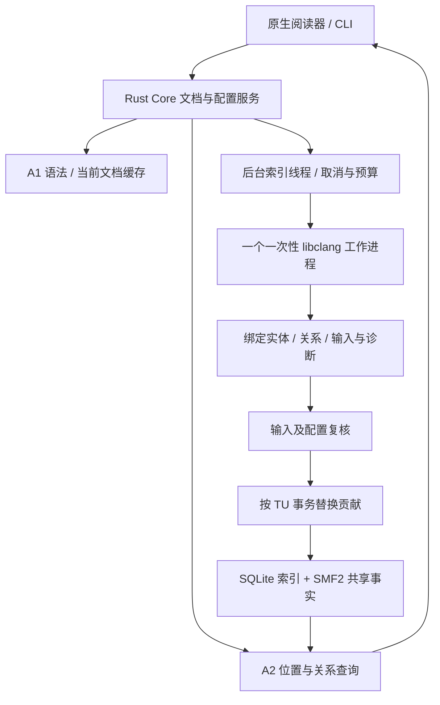

# C/C++ 语义闭环与 QEMU 验证

日期：2026-10-18。实现：Symweft 0.1.0，提取器 `a2-clang-v3`，存储格式 `a2-store-v2 / SMF2`。本报告记录已经落地的首版 A2；总体路线继续以低资源、快速分析、即时关系为中心。

后续实现与新的读取对照见 [实时语义更新与查询优化](11-实时语义更新与查询优化.md)。本报告保留首版阶段的结果与边界；其中尚未实现的文件监听和指纹缓存已经在后续阶段补齐。

## 1. 本轮交付与边界

本轮将“语法上看起来是调用”推进为“在指定构建配置下，由编译器绑定到具体声明的调用”，打通配置导入、按需/批量分析、持久化、位置查询、定义/引用/出入调用、变更失效和原生前端。

| 能力 | 当前实现 |
|---|---|
| 真实编译上下文 | 读取 compile_commands.json，保留宏、include、语言标准、目标等参数；记录响应文件与配置指纹 |
| C/C++ 身份与关系 | Clang USR、声明/定义、引用、调用者/目标；C linkage、C++ 重载、静态函数和匿名命名空间隔离 |
| 调用不确定性 | direct、virtual_candidate、indirect、unresolved；后两种不按同名猜测目标 |
| 持久化查询 | 按实体、调用方向、文件/字节范围建立索引；无需创建 AST 即可恢复关系 |
| 更新闭环 | 每个翻译单元独立归属；头文件反向依赖选出受影响单元；事务替换旧贡献 |
| 未保存内容 | 使用受限 overlay 进行编译器语义预览；返回修订，不写入磁盘基线 |
| 调度与资源 | 后台索引线程、单个一次性编译器工作进程、取消/超时/采样 RSS 预算 |
| macOS | 导入配置、分析当前文件、取消、随光标查询、定义跳转、出入调用列表；沿用系统主题 |

**这不是完整的 C++ 程序分析器，也不是 QEMU 全库语义分析完成。** 目前没有完整模板实例化/隐式析构覆盖、函数指针 points-to、虚调用动态目标展开、跨项目身份连接、CFG、图谱、文件监听和连续编辑语义 overlay 合并。macOS 仍是只读阅读器；内存编辑与预览通过协议验证。

## 2. 为何选择 libclang 与一次性工作进程

A1 Tree-sitter 继续承担打开文件后的快速结构反馈；A2 使用 libclang 的 C API 获取编译器语义。两者分别标注证据，不将语法候选升级为已解析调用。

libclang 可以直接获得 referenced cursor、USR、声明/定义、源码位置和诊断，不需要自行实现 C++ 名字查找、重载解析和预处理器。其 C API 有意只暴露部分 AST；复杂语义后续可能需要独立的 Clang LibTooling 提供器。参见 [Clang 官方介绍](https://clang.llvm.org/docs/LibClang.html) 和 [Cursor API](https://clang.llvm.org/doxygen/group__CINDEX__CURSOR__MANIP.html)。

首版每个 TU 启动一个工作进程，解析后提取紧凑事实并退出。收益是编译器故障隔离、AST 内存及时回收、无常驻 clangd/多份全库 AST，取消时可直接回收进程。代价是每个 TU 的进程启动和共享头重复解析，未实现 preamble/PCH 复用。后续只对少量活动单元保留可回收的预编译前导，必须先测实际收益和内存成本；[Clang TU API](https://clang.llvm.org/doxygen/group__CINDEX__TRANSLATION__UNIT.html) 描述了相关选项及成本。



## 3. 编译配置与实体身份

### 配置读取

`compile_commands.json` 支持 `arguments` 数组，以及使用 POSIX 参数规则的 `command` 字符串；Windows 当前要求前者。配置中的编译命令作为数据读取，**不通过 shell 执行，也不运行项目构建系统**。生成头文件需要用户先完成构建系统的配置/生成步骤。

移除 `-c/-o` 和依赖输出动作，保留影响语义的参数，处理 ccache/sccache 前缀、相对工作目录及 `@response` 文件。不支持的插件、modules、PCH、VFS overlay 等输入明确拒绝，不能静默省略后给出“准确”结果。当前主要支持 Clang/GCC 风格参数；MSVC/clang-cl 兼容仍待实现与验证。

| 输入 | 限制 |
|---|---|
| 编译数据库 | 32 MiB、100,000 条命令 |
| 响应文件 | 单个 1 MiB、最多 4 层展开、16,384 个参数 |
| TU 来源 | 已存在的 C/C++ 文件，位于源码根或编译数据库所在构建根 |
| 单次路径选择 | 128 项；空数组表示全部已配置 TU，支持 limit |

同一源码的多个编译命令保留为独立 TU。`configuration = hash(源码根, 编译数据库路径)`；`command_key` 包含工作目录、源码、编译器名、标准化参数和响应文件输入；`unit_id` 结合 configuration、文件与 command_key。数据库内容另有整体指纹，配置变动必须重新导入；重新导入会清理已经消失的单元贡献。

提供器指纹包含提取器版本、Clang 版本与库路径、macOS SDK 回退和相关 include/SDK 环境变量。跨目标分析应提供明确的 target/sysroot；当前 macOS 无显式 sysroot 时使用本机 SDK，不可据此声称支持任意交叉工具链。

即使 compile_commands 相同，不同启动环境的 CPATH/SDKROOT 也可能改变含义。配置状态输出 `incompatible_provider_units`，原生 UI 明确提示不匹配时重新分析，而不是把旧事实显示成当前关系。诊断可临时设置 `SYMWEFT_TRACE_PROVIDER=1`，向 stderr 输出提供器身份输入，不输出源码内容。

### 实体身份

实体 ID 是作用域域名与 Clang USR 的摘要，不使用显示名称作为连接键：

- 外部链接：源码根 + external + USR，允许同项目不同 TU 共享实体。
- internal/unique external：源码根 + unit_id + USR，区分 static、匿名命名空间及头文件中的每 TU 实例。
- 无链接声明：源码根 + 规范声明所在文件 + USR，保留共享头字段/typedef 的跨 TU 身份，同时区分同名不同路径文件。
- Lambda 暂用 TU + 文件位置生成局部身份；并非跨修订稳定的全局实体。

ID 目前属于当前工作空间；源码根迁移会变化，跨项目 ABI/包版本身份尚未建立。

## 4. 关系精度与源码位置

`direct` 表示编译器绑定到某个静态可调用声明，**不等于已经找到实现，也不等于证明运行时执行**。实现不在索引子集或属于系统库时，可能只有目标 ID。

`virtual_candidate` 表示声明已绑定，但可能发生动态派发；首版不枚举所有 override。函数指针、可调用变量/字段记录为 `indirect`，目标为空；编译器未暴露目标的调用记录为 `unresolved`。默认参数不被误算为函数体执行；Lambda 使用独立调用者。宏保留展开与拼写位置。

所有偏移均为零起点 UTF-8 字节，结束位置不包含在范围内；行列为 1 起点。符号名使用物理 token 范围，避免宏生成名称的字节长度越过真实源码。Swift 使用既有 UTF-8/UTF-16 转换定位。

头文件事实可能在多个 TU 重复出现。查询保留 `unit_id/main_file/input_key` 供调用者选择配置，而不是将不同宏分支无条件合并。UI 当前用主文件名和短 unit_id 区分；后续需要更清楚的目标、宏与工具链标签。

## 5. 持久化格式与 SQLite 决策

A1 缓存保持独立，A2 保存到工作空间缓存下的 `a2-clang-v2/index.sqlite3`。存储目录版本与提取器版本分别管理；提供器版本不匹配会拒绝复用旧结果。当前真实结构以 `crates/symweft-semantic/src/store.rs` 为准，早期 `analysis-storage-schema.sql` 仍是目标架构草案。

| 表 | 用途 |
|---|---|
| units | 编译单元身份、输入配置、提供器、状态与报告 |
| inputs / input_aliases | 实际加载文件的内容指纹；保留 include 路径别名及规范路径反查 |
| entities / paths | 字符串字典，关系索引只存整数 ID |
| facts | 内容寻址的压缩语义事实，同一事实可被多个 TU 共享 |
| symbols / refs / calls | 每 TU 的独立贡献、整数外键、位置范围和入/出方向索引 |

事实载荷是自定义版本化封装：

```text
SMF2[4 bytes] | 原始长度 u32 little-endian | Zstandard level 1 frame
                         ↓ 解压后
             bincode 2 standard 编码的 Symbol / Reference / Call
facts.digest = BLAKE3(未压缩编码字节)
```

每个事实最大 2 MiB，解压有大小界限，校验长度、摘要及解码消费长度。复用相同摘要时核对原始字节，损坏不会当作正常关系返回。使用可复用压缩/解压上下文，未开启多线程压缩；相关接口见 [zstd crate 文档](https://docs.rs/zstd/0.13.3/zstd/bulk/struct.Compressor.html)。

一次事务写入输入、贡献与新状态，替换某 TU 时只删除它拥有的贡献。共享事实的其他所有者不受影响。清理时回收无引用事实，WAL checkpoint 后页可复用；当前不会自动缩小 SQLite 文件，实体/路径字典的孤立条目也尚未回收。长期更新、碎片整理和迁移还需专门验证。

SQLite 使用 WAL、foreign_keys、NORMAL 同步、2 MiB 页缓存、关闭 mmap、250 ms busy timeout。数据是可重建索引；NORMAL 的耐久性不应用于未来用户注释等不可丢失资产。关系查询通过固定读事务，避免候选事实来自旧快照、输入校验却读取新发布快照。[SQLite WAL 官方说明](https://sqlite.org/wal.html)。

**结论：保留 SQLite 管理事务与二级索引，使用自定义紧凑事实格式；目前无需自研整个存储引擎。** 实测的主要膨胀来自重复 JSON、重复长键和头文件贡献；先解决这些问题后，数据库体积下降约 77%。本轮仍不能证明千万/亿级边适用，分段邻接存储继续作为后续基准方向。

## 6. 更新、一致性与未保存内容

1. 索引前比较 TU 提供器、命令及已加载输入；全部相同则复用，不启动编译器。
2. 变更的头文件通过 `input_aliases` 找到已经索引的包含者，重建相关 TU，不扫描无关 AST。
3. Clang 实际读取的文件内容与磁盘/overlay 比较；返回后再次校验配置和输入，拒绝分析过程中发生变动的结果。
4. 编译器出现 error/fatal、预算失败或取消，不发布半份“当前”快照；旧贡献标记失败/过期后从当前查询排除，其他 TU 保留。
5. `document.edit` 使相关磁盘基线失效；请求语义预览时使用精确 revision 的缓冲区，结果 `overlay=true,persisted=false`。
6. 已打开阅读器的内容与磁盘不一致时，位置查询返回 `stale_document`，避免新文件关系错误套用到旧文本。

预览目前为同步受限工作请求；后台索引运行时拒绝预览，歧义头文件/多命令必须指定 unit_id。它还不是连续编辑时的低延迟语义服务，也不会把 overlay 与整个磁盘关系图自动合并。

新鲜度具有明确范围：查询重新验证**实际返回贡献所属 TU 的已加载输入**；状态汇总中的 current 是最后记录状态。尚未索引的 TU、变更后新增的引用，不会由一次旧结果查询自动发现。新建遮蔽头文件、负向 include 搜索、目录搜索顺序和文件系统竞态尚未完整跟踪；需要显式刷新。没有文件监听器之前，不应把局部指纹校验宣传为完整工作空间实时一致性。

## 7. 资源控制与缓存边界

| 项目 | 默认与行为 |
|---|---|
| 并发 | 一个索引线程、一个活动编译器工作进程 |
| 单 TU 超时 | 默认 30 秒，可配置 1–120 秒；取消后 kill + wait 回收 |
| 工作进程内存 | 默认 512 MiB，可配置 32–4096 MiB，macOS/Linux 每约 250 ms 采样 RSS |
| 主文件 / overlay | 主文件 8 MiB；最多 16 个 overlay、内容总计 8 MiB |
| 已解析输入 | 总计 256 MiB，解析后复核；不是解析前的硬内存上限 |
| AST 提取 | 2,000,000 节点、250,000 事实、递归深度 256 |
| 工作进程协议 | 请求 12 MiB、stdout 64 MiB、stderr 256 KiB |
| 关系查询 | limit 1–1000；位置查询各类候选最多 32 |

采样 RSS 是软限制，可能短时超出，Windows 尚未实现该限制；它也不包括 Core/UI。macOS critical 内存压力会取消活动 A2 索引。A1 现有自动/手动热池和预读保留，**其设置不会自动限制 A2 的编译器或全部 RSS**。

A2 本轮没有常驻全库 AST、跨查询语义热池或热度驱动邻接预读。查询按需读取压缩事实，短期在单次请求内复用输入 hash；跨请求仍重新校验。本机查询已有数十毫秒延迟，下一步应采用文件监听 epoch + 有界输入指纹缓存，而不是取消新鲜度校验。结构语义热度也尚未替换 A1 的语法代理热度。

## 8. QEMU 真实配置与样本

机器：Apple M2 / 16 GiB，macOS 26.6.2，Apple Clang/libclang 21.0.0，Rust 1.99.0，release 构建。QEMU VERSION 11.1.1，提交 `2df3db357e2d59b7e56c8fa9b97cd035e67d473b`。未修改 QEMU 受版本控制的源码。

隔离依赖与构建位于 `build/semantic`：Python venv、Meson 1.11.1、Ninja 1.13.2、pkgconf 2.3.0、GLib 2.84.4。目标为 `aarch64-softmmu`，关闭默认可选特性、文档、工具、guest agent、plugins、Rust 和 werror；完成生成头文件/源文件后使用真实编译数据库。

配置命令的主要选项：

```sh
/path/to/qemu/configure --target-list=aarch64-softmmu \
  --without-default-features --disable-docs --disable-tools \
  --disable-guest-agent --disable-plugins --disable-rust --disable-werror \
  --python=/path/to/venv/bin/python --ninja=/path/to/venv/bin/ninja
```

配置含 2,855 个命令。本轮挑选 system、qom、qapi、util、hw/core、target/arm 的 30 个真实 TU；原计划的两个路径不在该配置中，已在原始数据列出。**未执行 2,855 个单元的完整语义分析，不能外推全量耗时或磁盘大小。**

本机 Apple Python 启动的基准进程继承 `CPATH=/usr/local/include`、`SDKROOT=/Library/Developer/CommandLineTools/SDKs/MacOSX.sdk`，已通过实际提供器指纹核对并记入原始数据。Finder/直接 shell 启动未必具有这些变量；复用此基准库必须使用同一环境，否则按新配置重建。后续基准脚本自动记录相关环境变量。

配置步骤下载了 QEMU 忽略目录下的子项目依赖，所以源码目录文件总数已不同于早先 A1 的 6,723 文件语料。A1 报告保留为历史测量，不将两组范围混用。

`system/runstate.c` 因 `block/cdp.h:81` 使用 `XATTR_NAME_MAX` 失败；直接使用该条原始编译命令的 `-fsyntax-only` 同样失败。未通过额外定义宏掩盖问题，数据库明确记录 failed，不发布部分语义。每次复查都会重新尝试这个失败单元，因此命令退出码为 1。

## 9. 测量结果

首次指空 A2 数据库，操作系统页缓存未清空；重复运行使用持久化索引。单次测试，不宣称统计稳定的冷盘吞吐。原始汇总见 [JSON](10-C-Cpp语义基准原始数据.json)，完整本机输出在 `build/semantic/qemu-final`。

| 指标 | 首轮 | 再次运行 |
|---|---:|---:|
| 选择 TU / 成功 / 失败 | 30 / 29 / 1 | 30 / 29 复用 / 1 重试失败 |
| 进程总 wall time | 16.83 s | 0.78 s |
| 内部索引循环 | 15.365 s | 0.565 s |
| Core 命令报告峰值 RSS | 149.53 MiB | 71.42 MiB |
| 成功工作进程累计最大峰值 RSS | 111.03 MiB | 无成功解析；报告复用旧值 |
| checkpoint 后数据库 | 109.67 MiB | 109.67 MiB |

命令 RSS 来自 macOS `/usr/bin/time -l`，工作进程值来自 rusage；两者不是整个进程树同一时刻的总内存，不能直接相加当作精确峰值。工作进程字段可能是本轮已退出子进程的累计最大值；不把 Clang 内部计费量当作 RSS。

已发布贡献为 194,192 个符号、224,359 个引用、17,530 个调用，共 436,081 条 TU 贡献；内容寻址事实 168,967 条，压缩载荷 31.55 MiB。共享头重复贡献仍保留正确归属，物理载荷复用。

与同一 30 TU 集合的初始 JSON/长字符串索引原型相比，数据库从 486.63 MiB 降至 109.67 MiB（约减少 77.5%），内部构建循环由 22.122 s 降为 15.365 s。优化包含整数键、共享事实、二进制编码、压缩及提取器修订，不是单独压缩算法的因果对照；最终命令报告 RSS 高于早期原型，后续仍需降低发布阶段峰值。

### 持久化读取与真实调用链

验证链路：`system/main.c:71 → qemu_init（system/vl.c:2854）→ 调用目标`。该函数定义 1 个、索引子集中入调用 1 个、出调用点 405 个：403 direct、2 unresolved。结果表示本次已索引范围，不表示运行时次数或完整程序调用图。

下面每项重复 30 次，包含 stdio IPC、输入指纹、SQLite、解压与解码，不含 AST 和 UI 绘制；系统页缓存未清空，采样 p95 为排序后的第 29 个样本。

| 查询 | p50 | p95 |
|---|---:|---:|
| 位置/所在函数 semantic.at | 31.31 ms | 34.42 ms |
| 定义 | 19.26 ms | 22.54 ms |
| 入调用 | 17.18 ms | 23.83 ms |
| 出调用（405 项） | 22.74 ms | 26.08 ms |

这些延迟支持首版按光标防抖读取，仍有优化空间；不把它们当作纯数据库内存命中延迟。UI 当前请求最多 100 项、先显示 30 项，API 基准使用上限 1000。

## 10. 协议与使用

完整参数见 [本地核心协议](04-本地核心协议.md)。主要入口：

```json
{"id":1,"method":"workspace.open","params":{"root":"/path/to/project"}}
{"id":2,"method":"semantic.configure","params":{"compile_commands":"/path/to/build/compile_commands.json","timeout_seconds":30,"worker_memory_mib":512}}
{"id":3,"method":"semantic.index","params":{"paths":["src/main.cpp"]}}
{"id":4,"method":"semantic.progress","params":{}}
{"id":5,"method":"semantic.at","params":{"path":"src/main.cpp","byte_offset":123}}
{"id":6,"method":"semantic.relations","params":{"entity_id":"<真实查询返回的 ID>","direction":"incoming","limit":100}}
```

命令行先构建再分析：

```sh
cargo build --locked --offline --release -p symweft-core
# 全部已配置 TU；可在后面追加相对源码路径，仅分析所选范围
./target/release/symweft-core semantic-index /path/to/project /path/to/build/compile_commands.json
# 重新测量同一 QEMU 子集，使用新目录，避免覆盖原始空库成绩
python3 scripts/benchmark-cpp-semantic.py --output build/semantic/qemu-next
# 验证已有 QEMU 子集的关系与查询延迟
python3 scripts/check-qemu-semantic.py --cache build/semantic/qemu-final/cache
```

QEMU 本机已有构建配置可直接导入；macOS 菜单“工作空间 → 导入 C/C++ 编译配置”，选取 `build/semantic/qemu-build/compile_commands.json`。可先在 CLI 分析选定范围，再用相同 `SYMWEFT_CACHE_DIR` 启动应用查看已有关系。配置导入本身不自动启动 2,855 个 TU 的后台全量任务。

在项目根复用本机这份基准库查看原生界面：

```sh
CPATH=/usr/local/include \
SDKROOT=/Library/Developer/CommandLineTools/SDKs/MacOSX.sdk \
SYMWEFT_CACHE_DIR="$PWD/build/semantic/qemu-final/cache" \
build/macos/Symweft.app/Contents/MacOS/Symweft \
  --workspace "$PWD/test_code/qemu" --file system/vl.c \
  --compile-commands "$PWD/build/semantic/qemu-build/compile_commands.json"
```

## 11. 验证与后续顺序

工作空间 27 项 Rust 测试和 clippy 通过。6 项语义测试覆盖重载/虚调用/函数指针、宏与静态身份、头文件变更/错误/overlay、响应文件/多变体/事务回滚、进程超时取消回收、共享头身份/事实归属/损坏检测。生产 stdio 检查补充了跨 C/C++ linkage、保存替换、头文件选择、过期阅读器、重启复用和配置变化。

Swift foundation 检查使用实际 Core 完成配置、异步索引、模型解码和跨文件定义查询；原生双主题窗口另行验收。窗口图层导出可能省略系统合成玻璃材质，不作为完整桌面截图。

后续按收益推进：

1. 文件监听与输入 epoch，A2 有界查询缓存、活动文件优先调度，降低反复 hash 与发布峰值。
2. 连续编辑 overlay、可取消异步预览和受限 preamble 复用；不先扩大并发。
3. 扩大 C++ 真实项目覆盖、隐式调用/模板、编译器驱动兼容与更清楚的变体 UI。
4. QEMU 全配置、长期增量、10 倍/100 倍事实和故障恢复基准，再判断是否需要外部分段邻接后端。
5. 真实调用图与架构聚合、跨项目证据连接；随后扩展其他语言的准确语义提供器。
