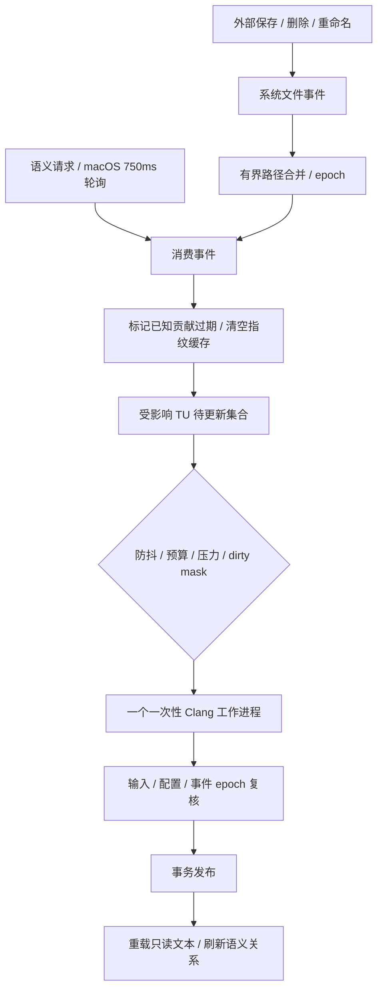

# 实时语义更新与查询优化

日期：2026-10-18。承接 [首版 C/C++ 语义闭环](10-C-Cpp语义闭环与QEMU验证.md)。本轮没有改动 Clang 事实提取器身份或 SMF2 载荷格式，重点完善失效、自动重建和读取成本。

后续阶段已完成异步单 TU 未保存预览与修订保护，见 [异步语义预览](12-异步语义预览与修订一致性.md)；下文实测保留为本阶段的磁盘读取基线。

## 1. 本轮已实现

- 原生文件事件：监听源码根与构建根，处理保存、删除、重命名、原子保存、新增头文件和事件溢出。
- 自动更新已索引范围：防抖、合并、活动文件优先、单工作进程；不因导入配置就自动分析整个项目。
- 持久查询连接和有预算的输入指纹缓存，保留严格逐次内容校验模式。
- 未保存缓冲区阻止磁盘语义重新冒充当前结果；释放缓冲区后继续等待中的重建。
- 显式取消暂停自动任务，恢复时保留待更新单元；critical 内存压力暂停编译器，压力恢复后继续。
- 首次分析失败、尚未保存输入依赖的 TU，也能在主文件修复后自动重试。
- macOS 原生自动更新/严格校验开关、刷新已索引范围，以及外部保存后源码与关系联动更新。

当前仍是只读前端，未接通用户输入/保存；协议的文档缓冲区、dirty mask 和不落盘预览用于验证后续编辑链路。没有把指纹缓存称为完整语义事实热池，也没有新增常驻全库 AST。

## 2. 事件与调度

使用固定版本 notify 8.2.0 的系统推荐后端，本机实际为 FSEvents。其上游说明文件事件可能丢失，不能把通知当作唯一事实依据；见 [官方库文档](https://docs.rs/notify/8.2.0/notify/) 与 [need_rescan 定义](https://docs.rs/notify/8.2.0/notify/struct.Event.html#method.need_rescan)。



事件回调不解析代码、不访问数据库；它收集有界路径并更新 epoch。实际失效和重建由语义请求驱动，macOS 持续轮询保证空闲窗口也能响应保存。**纯 serve 客户端若不再发送请求，只会收集事件，不会自行启动分析。** 这一阶段采用协作式维护，不声称已经实现独立常驻的完整后台调度服务。

| 控制项 | 行为 |
|---|---|
| 监听范围 | 源码根、编译数据库所在构建根；重叠根避免重复监听，对支持的后端关闭符号链接递归，外部符号链接目标不视为完整覆盖 |
| 路径集合 | 最多 1,024 项，重复合并；溢出或 need_rescan 保守失效全部已记录单元 |
| 噪声过滤 | 忽略读取/访问时间、当前工作空间索引缓存、.git 和常见目标/依赖/日志文件 |
| 防抖 | 消费变化后静默 350 ms；持续变化最多等待约 2 秒后尝试调度 |
| 自动单元上限 | 256；超过则全部标记过期、暂停自动重建并提示手动刷新，不偷偷只处理前 256 个 |
| 并发 | 延续单工作进程；当前打开的主文件优先 |
| 失败与恢复 | 解析失败不会无限重试；等待新的文件变化或用户刷新 |
| 取消 | 暂停自动任务，保留预算内待更新集合；恢复时继续 |
| 内存压力 | critical 取消活动工作进程、清理指纹缓存并暂停后台启动，normal/warning 后可恢复；用户取消状态独立保留 |

已知输入的修改通过反向包含关系找出所有者；查询也关联 TU 主文件，覆盖首次失败还没有依赖快照的情况。新建/删除/重命名常见源码、头文件、生成定义文件和目录，可能改变 include 搜索，因此采用更保守的已记录范围失效。此处只处理已记录单元，配置中从未请求的其他文件保持未索引。

本轮实际验收平台为 macOS；Linux/Windows 原生后端和行为尚待对应系统验证。

监听错误会降级为严格内容查询，停止自动重建并输出错误；当前不自动轮询全磁盘弥补监听失败。SDK、外部依赖目录及符号链接外部目标不属于完整监听范围；已加载输入仍在查询时验证。

## 3. 新鲜度和资源成本

上一版每次请求重新打开 SQLite，并读取编译数据库和相关头文件内容。现在一个 Controller 复用查询连接、语句缓存和 2 MiB SQLite 页缓存；后台索引仍用单独连接，读事务的一致性边界保持不变。

输入验证分两种模式：

| 模式 | 行为与适用范围 |
|---|---|
| strict | 每次校验实际读取内容；CLI 默认仍使用此模式，可用于对照和保守环境 |
| metadata cache | 先比较文件属性；一致且未到期时复用内容摘要，收到事件清空缓存；macOS 前端默认启用 |

属性包含长度、修改时间，Unix 另含设备号、inode、ctime 和 ctime 纳秒。Unix 指纹最多复用 2 秒，其他平台最多 100 ms，过期重新读取内容。哈希读取前后核对属性，发现变化则不承认该输入；使用 64 KiB 缓冲区流式 BLAKE3，避免为每次验证分配整份编译数据库或大头文件。

配置输入与语义输入分别有一个估计字节上限为 1 MiB、最多 8,192 项的池，保存路径、属性和摘要，不保存源码或 AST；按最近使用淘汰。`charged_bytes` 包括估计条目开销，不等于分配器实测或 RSS 硬上限。A1 设置中的热缓存 MiB 仍不控制这两个独立小池或编译器。

内容读取、系统通知和 SQLite 事务不是整个文件系统的原子快照。网络文件系统、属性精度、漏报、监听启停间隙，以及启动监听之前已经改变的负向 include 搜索，都还有边界。严格模式也只验证已加载的输入，不能单靠旧输入 hash 发现所有新头文件；需要显式“刷新已索引范围”强制重新解析。不能将短时属性复用宣传为严格逐字节实时一致性。

本轮没有引入跨查询的解压语义事实热池、图邻接预读或 preamble 常驻缓存；后续需要独立测量其收益与失效复杂度。

## 4. 任务和缓冲区一致性

- 文件事件推进查询指纹 epoch；可能改变 include 搜索的结构事件另推进 publish_epoch。发布前严格复核已加载输入、配置和结构 epoch，避免普通无关写入无谓丢弃编译结果；过期返回值丢弃后合并任务重建。
- 活动工作被事件取消时，保留其原有任务范围，避免批次中后续单元消失；超过自动预算则要求手动刷新。
- dirty 文档对应的 TU 从自动队列中暂时阻塞，磁盘事实持续遮蔽；其他可分析单元仍能推进。已阻塞集合保留等待状态，保存后重开或关闭丢弃缓冲区才继续。
- 修改编译数据库或响应文件，提示重新导入；不静默按旧参数继续发布。
- `watch.revision` 是当前 Controller 的 UI 刷新 token，不是全项目数据库 generation。UI 对旧光标请求、旧工作空间和旧刷新 token 的返回值均做拦截。
- macOS 当前为只读，可在外部保存后重载磁盘文本，并按原行/列选择邻近有效 UTF-8 位置；未来接通用户编辑后必须改为冲突提示，不能直接覆盖未保存文本。

## 5. 协议与 UI

### 新接口

```json
{"id":40,"method":"semantic.watch","params":{"enabled":true,"auto_refresh":true,"metadata_cache":true}}
{"id":41,"method":"semantic.progress","params":{}}
{"id":42,"method":"semantic.cancel","params":{}}
{"id":43,"method":"semantic.watch","params":{"enabled":true,"auto_refresh":true,"metadata_cache":false}}
{"id":44,"method":"semantic.refresh","params":{}}
```

`semantic.watch` 配置监听和自动策略，任务运行期间先取消或等待完成。`semantic.refresh` 强制重新分析**已经记录的单元**，不会扩大到编译数据库全量；也可用于补偿监听开始前的 include 搜索变化。`semantic.index` 仍保留按路径/limit 分析配置单元和按指纹复用的原含义。

`semantic.progress/status` 增加 watch：enabled、auto_refresh、metadata_cache、monitor、pending_units、paused、pressure_paused、revision、invalidated_units、auto_jobs、manual_refresh_required、configuration_required、error、fingerprints、configuration_fingerprints、max_auto_units。monitor 报告后端、根、epoch、事件数、溢出与降级。fingerprints 报告命中、哈希数、读取字节、淘汰、条目、估计计费和实际启用状态。

job 增加 `trigger=manual/watch`。前端在每次轮询消费事件并推进自动调度；UI 默认 750 ms 间隔，测试协议使用更频繁的轮询，两者端到端延迟不能混同。

### 交付设计工具的补充要点

- 在语义面板提供“自动更新已索引文件”和“严格内容校验”，不把自动开关描述为全库自动扫描。
- 区分“分析当前文件”和“刷新已索引范围”，后者明确会重新解析当前已知范围。
- 状态至少区分等待防抖、更新中、待更新、用户暂停、内存压力暂停、范围过大需手动刷新、配置变化需重导入、监听失败降级。
- 更新期间清除旧语义确定性展示，但保持源码和可用 A1 结构；不弹出全屏等待。
- 外部保存后源码与关系在同一阅读位置更新；未来可编辑模式必须增加外部修改冲突状态。
- 所有开关、列表、提示使用原生语义颜色，继续实时跟随系统浅色/深色。

## 6. 验证与 QEMU 对照

本轮增加真实原生事件检查、指纹缓存边界与同长度/恢复 mtime/原子替换测试。QEMU 读取对照使用上一轮 29 个成功 TU 的持久化基线副本，保留原来的编译错误记录；不修改 QEMU 受版本控制的源码，不把该子集当作全库语义完成。

测试脚本：

```sh
cargo test --locked --offline --workspace
cargo clippy --locked --offline --workspace --all-targets -- -D warnings
python3 scripts/check-semantic.py
python3 scripts/check-semantic-realtime.py
bash scripts/check-macos.sh
SYMWEFT_BUILD_CONFIG=release bash scripts/build-macos.sh
python3 scripts/check-macos-realtime.py
python3 scripts/check-qemu-semantic.py --validation strict --output /tmp/qemu-strict.json
python3 scripts/check-qemu-semantic.py --validation cached --output /tmp/qemu-cached.json
```

已在同一 release 核心、同一 QEMU 基线副本上各测 30 次/查询；先严格模式，再缓存模式。包含 stdio IPC、配置/输入验证、SQLite 和事实解码；不包含 AST、UI 和冷盘启动，计时前已有预热查询。缓存侧监听正常、事件为 0、自动重建关闭，关系均为 1 个定义、1 个入调用、405 个出调用点。

| 查询 | 严格 p50 / p95 | 缓存 p50 / p95 |
|---|---:|---:|
| 位置/所在函数 | 37.42 / 41.07 ms | 3.22 / 3.94 ms |
| 定义 | 17.64 / 19.51 ms | 1.09 / 1.20 ms |
| 入调用 | 16.05 / 17.39 ms | 1.13 / 1.31 ms |
| 出调用 405 项 | 24.35 / 28.99 ms | 7.73 / 9.16 ms |

本次两个指纹池共计费 204,323 字节（约 199.5 KiB），语义输入 687 项、配置输入 1 项。整段检查的逻辑内容读取量从约 1497.8 MiB 降至 10.7 MiB；这是读取字节计数，不是物理磁盘 I/O。

Core RSS 在每类查询结束后采样：严格模式约 68.09–69.52 MiB，缓存/原生监听模式约 71.20–72.59 MiB。这是观测点，不是过程峰值；差值包含监听、分配器及 SQLite 状态，不能全归因于缓存。

缓存模式额外做了约 0.8 秒、10 次空闲 progress 查询：新增输入 hash 为 0、新增配置 hash 为 0、自动分析任务为 0。不能将这一短测当作全天空闲 CPU 证明。

原生事件协议检查覆盖保存、头文件、遮蔽头增删、原子替换、突发保存、dirty 缓冲区、取消恢复、内存压力、手动已知范围刷新、设置切换时保留待处理保存、首次失败后修复与配置变化。保存/头文件事件在该小样本约 0.5–0.8 秒内完成更新；测试每 75 ms 轮询，macOS 750 ms 轮询可能更慢。原生浅色、深色窗口均验证外部原子保存后文本重载和绑定目标 first → second。

工作空间 31 项 Rust 测试通过，其中新增真实 257 TU 元数据范围的原生事件预算测试，确认超限全部过期、自动工作进程启动数为 0；clippy、既有语义协议、原生事件协议及 Swift 检查通过。原始汇总见 [JSON](11-实时语义更新基准原始数据.json)，完整本机查询输出位于 build/semantic/qemu-realtime。

本轮读取优化不等于完整编译阶段内存优化；上一轮约 150 MiB 的命令峰值尚需另做发布阶段剖析。后续主线为连续编辑异步预览与受限 preamble 复用、语义事实热池、更多真实 C++ 项目与完整配置规模验证。
